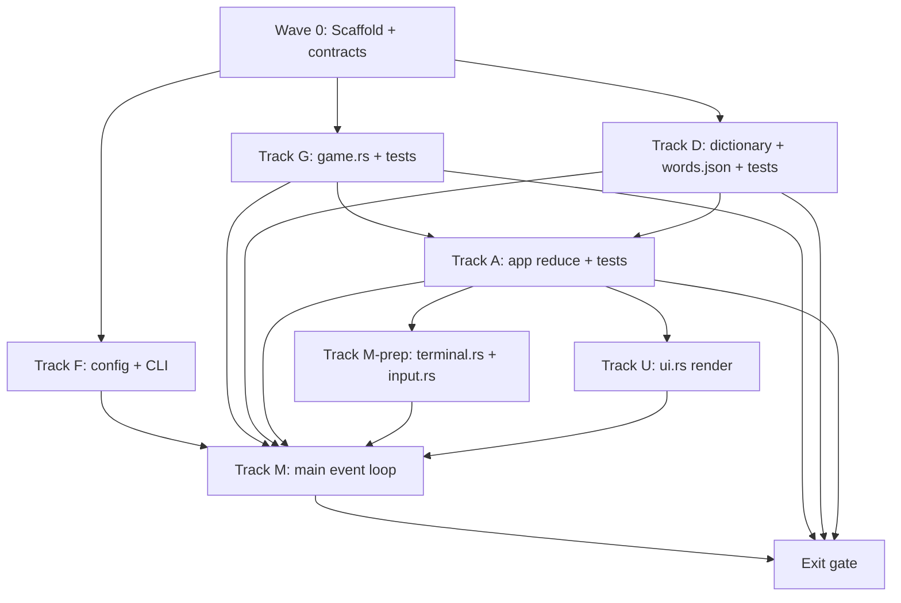

# Anagram TUI — Implementation Runbook

**Spec:** [SPEC.md](./SPEC.md)  
**Goal:** Ship v1 with parallel workstreams where possible, then integrate in defined checkpoints.

---

## Infrastructure (verified)

| Item | Status |
|------|--------|
| Repository | **Greenfield** — only `docs/SPEC.md`, `docs/RUNBOOK.md`; **no git**, no `Cargo.toml`, no `src/` |
| Rust toolchain | **Available** — `rustc` / `cargo` on PATH (≥ SPEC MSRV 1.75+) |
| CI / GitHub Actions | **None** — add in Optional Wave 4 after `git init` |
| Word data | **None** — Track D creates `data/words.json` |
| Remote / Origin | **None** — not required for v1 |

**Layout note:** SPEC §6.1 lists modules under `src/` without `lib.rs`. This runbook uses a **lib + bin** crate so `cargo test` exercises logic without a terminal; implementation modules still match SPEC (`game`, `app`, `ui`, …).

**Prerequisites before Wave 0:** `cargo --version` succeeds; run commands from the repo root (this workspace).

---

## How to use this runbook

1. Complete **Wave 0** (single owner) — everyone needs the same crate layout and interfaces.
2. Run **Wave 1** tracks **G, D, F in parallel** — each track owns files in *Scope* only.
3. **Checkpoint 1** — merge; then Track **A** (sequential).
4. **Checkpoint 2** — then **Wave 2** (U + M-prep in parallel), **Wave 3** (M integrates).
5. Close with **Exit gate:** `cargo test`, manual TUI smoke, terminal restored after quit.

**Agent tip:** After Wave 0, spawn up to **three** subagents (G, D, F). After Checkpoint 1, one for **A**. After Checkpoint 2, two for **U** and **M-prep**, then one for **M**.

---

## Dependency overview



| Symbol | Meaning |
|--------|---------|
| Wave 0 | Blocks all parallel work |
| Tracks G, D, F | Can run fully in parallel after Wave 0 |
| Track A | Starts only after Checkpoint 1 — G and D APIs are real, not stubs |
| Tracks U, M-prep | After Checkpoint 2 (logic complete) |
| Track M | After U and M-prep |
| Track M-prep | After Checkpoint 2 — needs `app::Action` for `input.rs` |

---

## Wave 0 — Scaffold & contracts (sequential, ~30 min)

**Owner:** one worker. **Output:** `cargo build` succeeds; modules exist; types agreed.

| Step | Task | Artifact |
|------|------|----------|
| 0.0 | Confirm `cargo` on PATH; optional `git init` (recommended before parallel branches) | local env |
| 0.1 | `cargo init --name anagram`, add dependencies from SPEC §6.1; `crate-type` lib + bin (default once `lib.rs` exists) | `Cargo.toml` |
| 0.2 | `lib.rs` declares **all** modules with compiling stubs: `app`, `cli`, `config`, `dictionary`, `game`, `input`, `terminal`, `ui` | `src/lib.rs`, one file per module |
| 0.3 | `main.rs`: `fn main() -> anyhow::Result<()> { anagram::run(anagram::cli::Cli::parse()) }` — `run` is `unimplemented!()` until Track F | `src/main.rs` |
| 0.4 | Define **shared types** (empty impls OK): `Round` in `game`; `Phase`, `GameState`, `Action` in `app`; `WordEntry`, `ClueKind` in `dictionary`; `AppConfig` in `config`; `Cli` stub in `cli` | type shells per module |
| 0.5 | `data/words.json` as `[]`; `dictionary` uses `include_str!(concat!(env!("CARGO_MANIFEST_DIR"), "/data/words.json"))` | `data/words.json`, loader stub |
| 0.6 | Document public API in module comments (`game`: `Round`, …; `app`: `reduce`; `dictionary`: `random_word`) | module tops |

**Done when:** `cargo build` and `cargo test` green (stubs may use `#[test] fn placeholder() {}` only in W0 if desired).

---

## Wave 1 — Parallel tracks

### Track G — Game engine (`game.rs`)

**Scope:** `src/game.rs` only (+ `#[cfg(test)]` in same file).  
**Depends on:** Wave 0.  
**Does not touch:** `lib.rs`, `ui.rs`, `main.rs`, `data/*`.

| Task | Detail |
|------|--------|
| G.1 | `Round::new(word, rng)` → pool shuffle, empty answer, `cursor = 0` (solution on round, not shown by UI) |
| G.2 | `try_type_letter`, `backspace`, `move_cursor` — cursor slots; backspace appends to pool |
| G.3 | Multiset helper + debug assert for invariant |
| G.4 | `check_solution` on full answer; wrong vs correct |
| G.5 | `reset_same_word` — re-shuffle, clear answer |
| G.6 | Inject RNG trait/`StdRng` seed for tests |
| G.7 | Unit tests per SPEC §6.6 (game rows) |

**Done when:** `cargo test round` (or your `game` test name filter) passes locally; other tracks may still be stubs until Checkpoint 1 merges.

**Prompt pack:** “Implement SPEC §3–3.4 in `game.rs` with seeded RNG and full §6.6 game tests. No terminal code.”

---

### Track D — Dictionary & content (`dictionary.rs` + data)

**Scope:** `src/dictionary.rs`, `data/words.json`.  
**Depends on:** Wave 0 `WordEntry` shape.  
**Does not touch:** `lib.rs`, `game.rs`, `ui.rs`.

| Task | Detail |
|------|--------|
| D.1 | JSON schema: `word`, optional `difficulty`, `clues[]` with `kind` + `text` |
| D.2 | Load embedded JSON; index or filter by length |
| D.3 | `random_word(len, rng)` for round start |
| D.4 | Clue metadata accessors (ordered clues, cap 3 at app layer) |
| D.5 | Seed **v1 word list** — at least 3 words per length 4–8 for manual play |
| D.6 | Unit tests: filter by length, empty list, invalid **entries** (skip/malformed word); compile-time JSON via `include_str!` must stay valid |

**Done when:** tests pass; JSON validates by hand.

**Prompt pack:** “Implement dictionary load/filter and seed `data/words.json`. Tests per SPEC §6.6 dictionary row.”

---

### Track F — Config & CLI

**Scope:** `src/config.rs`, `src/cli.rs`, `pub fn run(cli: Cli)` in `lib.rs` (stub only — no TUI).  
**Depends on:** Wave 0.  
**Does not touch:** `main.rs` after Wave 0 (already wires CLI → `run`).  
**Parallel with:** G, D.

| Task | Detail |
|------|--------|
| F.1 | `AppConfig`: min/max size, locale, theme placeholder |
| F.2 | Load `~/.config/anagram/config.toml` with defaults if missing |
| F.3 | clap: `--config`, optional `--plain` stub |
| F.4 | Unit test: default config + parse minimal TOML |
| F.5 | Replace `run` stub: load config, return `Ok(())` (no ratatui) |

**Done when:** `cargo test` for config/cli; `cargo run -- --help` works.

**Prompt pack:** “Config + clap only; no ratatui event loop.”

---

## Checkpoint 1 — API freeze

**Sequential, ~15 min.** One worker.

- [ ] Parallel branches **merged** (or single branch with G + D + F committed together)  
- [ ] `game` public API stable for `app` consumption  
- [ ] `dictionary::random_word` + `WordEntry` stable  
- [ ] `cargo test` and `cargo build` green on integrated tree  

If interfaces change, update module-level API comments only — no UI yet.

---

## Wave 1 (continued) — Track A — App layer (`app.rs`)

**Scope:** `src/app.rs`.  
**Depends on:** Checkpoint 1 (G + D).  
**Can parallel with:** late G/D test fixes only if no API change.

| Task | Detail |
|------|--------|
| A.1 | `GameState` owns `Round` (from `game`), phase, size, `clues_used`, status / clue text |
| A.2 | Define `Action` enum for SPEC §4.5 commands (no `crossterm` types here) |
| A.3 | `reduce(state, action) -> GameState` — pure transitions |
| A.4 | Clue application: definition (text only), first letter (pool/slot), others as SPEC §4.4 |
| A.5 | Phase transitions: menu, size select, playing, help, win |
| A.6 | Size select presets 4–10 + clamp to config min/max |
| A.7 | Unit tests: action sequences, clue side effects, invariants via `game` |

**Done when:** `app` tests pass; no `ratatui` import in `app.rs`.

**Prompt pack:** “Wire game + dictionary in pure `app.rs`; test clue cap and phases.”

---

## Checkpoint 2 — Logic complete

- [ ] `cargo test` full suite green  
- [ ] No `ratatui` in `game`, `dictionary`, `app`  
- [ ] Acceptance criteria 1–6 exercisable via `reduce` + unit tests; 7–8 verified at Exit gate  

---

## Wave 2 — Parallel UI vs polish

### Track U — Rendering (`ui.rs`)

**Scope:** `src/ui.rs`.  
**Depends on:** Checkpoint 2 (`GameState` final fields).  
**Parallel with:** Track M-prep.

| Task | Detail |
|------|--------|
| U.1 | Layout: header (length, clues used), pool, answer, clue panel, footer keys |
| U.2 | Styles per SPEC §6.4; error indicator without color-only |
| U.3 | Help overlay (`?`) |
| U.4 | Size-select screen UI |
| U.5 | Win / “not quite” banner |
| U.6 | Clue text wrap; min 80 cols |

**Done when:** `pub fn draw(frame: &mut Frame, state: &GameState)` compiles; optional `#[cfg(test)]` smoke with `TestBackend` (no full event loop).

**Prompt pack:** “ratatui-only rendering from `&GameState`; no input loop.”

---

### Track M-prep — Terminal & input helpers

**Scope:** `src/terminal.rs`, `src/input.rs` only.  
**Depends on:** Checkpoint 2 (`app::Action` enum stable).  
**Parallel with:** U.

| Task | Detail |
|------|--------|
| M0.1 | `enter_raw_mode` / `leave_raw_mode` with `Drop` guard (always restore) |
| M0.2 | Poll → `crossterm::event::Event` |
| M0.3 | `input.rs`: map `Event` → `Option<Action>` (SPEC §4.5 keys; printable `a-z`, backspace, `n/s/c/r/q/?`) |

---

## Wave 3 — Integration (`lib.rs::run`) — sequential

**Owner:** one worker after U + M-prep.  
**Scope:** flesh out `run()` in `lib.rs`; do not grow `main.rs` beyond Wave 0.

| Step | Task |
|------|------|
| M.1 | `run(cli)`: merge F’s config load + load `Dictionary` + `TerminalGuard::enter()` |
| M.2 | Initial `GameState` (menu or default size) → first round via `dictionary` + `Round::new` |
| M.3 | Loop: `ui::draw` → `terminal::poll` → `input::map_event` → `app::reduce` → draw |
| M.4 | `Action::Quit` / Ctrl+C → drop guard → canonical mode |
| M.5 | Resize event triggers redraw only |
| M.6 | Manual smoke script below |

---

## Exit gate

```bash
cargo test
cargo build --release
cargo run --
```

**Manual smoke (5 min):**

1. Pick size 5 → pool has 5 letters.  
2. Type letters → pool shrinks, answer fills L→R.  
3. Backspace → letter returns to pool end.  
4. Wrong full word → message; backspace fixes.  
5. Correct word → win state.  
6. `c` clue → cap 3; first-letter clue respects invariant.  
7. `q` quit → shell echo/prompt normal.

Map to SPEC §9 acceptance criteria 1–8.

---

## Parallelization matrix

| After | Parallel tracks | Max workers |
|-------|-----------------|-------------|
| Wave 0 | G, D, F | 3 |
| Checkpoint 1 | A only | 1 |
| Checkpoint 2 | U, M-prep (both need A merged) | 2 |
| Wave 3 | M only | 1 |

**Estimated agent time (parallel):** Wave 0 + CP1 ~45m; Wave 1 ~45m wall if 3 agents; A ~30m; U + M-prep ~30m parallel; M ~30m → **~2h wall** with 3 agents, **~2.5h** single agent.

---

## File ownership (avoid merge conflicts)

| File / dir | Owner track |
|------------|-------------|
| `src/game.rs` | G |
| `src/dictionary.rs`, `data/words.json` | D |
| `src/config.rs`, `src/cli.rs` | F |
| `src/lib.rs` | Wave 0: `mod` tree + `run` unimplemented; F: `run` stub; M: event loop |
| `src/app.rs` | A |
| `src/ui.rs` | U |
| `src/terminal.rs`, `src/input.rs` | M-prep |
| `src/main.rs` | **Wave 0 only** — thin `main`; no later edits |
| `data/` | Wave 0 creates dir; D owns `words.json` |
| `Cargo.toml` | Wave 0; dependency changes coordinated at checkpoints |
| `.git/` | Optional at Wave 0.0; required before Wave 4 CI |

**Rule:** Event loop lives only in `lib.rs::run` (Track M). Track F implements config loading inside `run`, not a second CLI entry path.

---

## Risk register

| Risk | Mitigation |
|------|------------|
| API churn between G and A | Checkpoint 1; thin `game` surface |
| `main.rs` / `lib.rs` contention | F: thin `main` + `run()` stub; M: flesh out `run()` only |
| Clue logic bugs | Tests in A.7 before U |
| Terminal left raw | `Drop` guard + smoke step 7 |
| Empty word list for size | D.5 minimum content; dictionary test |
| Parallel branches won’t `cargo test` together | Integrate at Checkpoint 1 before Track A |
| No git history | `git init` at Wave 0.0 if using branches or CI |

---

## Data pipeline (signature index)

Regenerate enlarged lexicon and anagram index per [RUNBOOK_SIGNATURE_INDEX.md](./RUNBOOK_SIGNATURE_INDEX.md) (`make data`, `anagram solve`).

---

## Follow-on features (separate runbooks)

| Feature | Spec | Runbook |
|---------|------|---------|
| Signature index & expanded lexicon | [SPEC_SIGNATURE_INDEX.md](./SPEC_SIGNATURE_INDEX.md) | [RUNBOOK_SIGNATURE_INDEX.md](./RUNBOOK_SIGNATURE_INDEX.md) |
| Letter workbench (cue grid) | [SPEC_LETTER_WORKBENCH.md](./SPEC_LETTER_WORKBENCH.md) | [RUNBOOK_LETTER_WORKBENCH.md](./RUNBOOK_LETTER_WORKBENCH.md) |

---

## Optional Wave 4 (not v1-blocking)

Can run in parallel after exit gate (requires `git init`):

- `.github/workflows/ci.yml` — `cargo test`, `cargo clippy -- -D warnings`  
- README install/run  
- `rustfmt.toml` + `cargo fmt --check`  
- Config persistence of last size (SPEC v1.1)

---

## Track checklist summary

Copy for issue board:

```
[ ] W0 Scaffold
[ ] G  Game + tests
[ ] D  Dictionary + words.json + tests
[ ] F  Config + CLI + tests
[ ] CP1
[ ] A  App + tests
[ ] CP2
[ ] U  UI render
[ ] M0 Terminal helpers
[ ] M  Main loop + smoke
[ ] Exit gate
```
