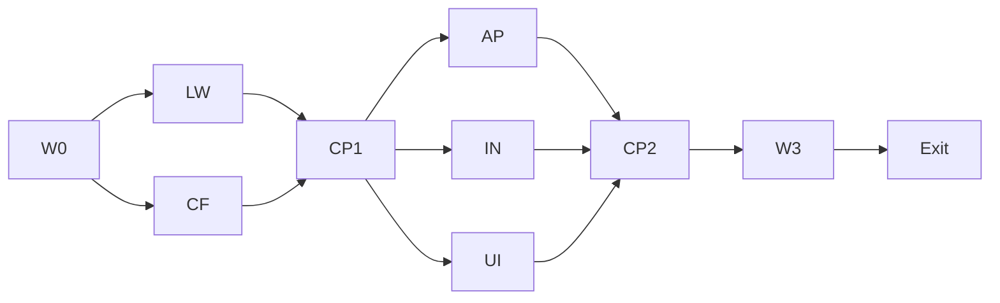

# Letter Workbench — Implementation Runbook

**Version:** 1.5  
**Spec:** [SPEC_LETTER_WORKBENCH.md](./SPEC_LETTER_WORKBENCH.md) (v1.2)  
**Parent:** [RUNBOOK.md](./RUNBOOK.md), [SPEC.md](./SPEC.md)  

**Goal:** Optional cue grid (separate grid pool, `[g]` focus, Space pick/place). Answer / win unchanged. **Parallel subagents**, strict file ownership.

**Non-goals:** lexicon, signature index, CLI `solve`, `game.rs` edits.

---

## Infrastructure

| Item | Today | After feature |
|------|--------|----------------|
| `map_event(&Event, Phase)` | Shipped | `map_event(&Event, &EventContext)` (**W0**) |
| `reduce` | `dict`, `index`, `rng` — no config | uses `GameState.workbench_settings` |
| `run_play` | `with_bounds` + loop | W0 sets `workbench_settings` from `AppConfig` |
| `workbench.rs` / grid UI | absent | W1–W2 |

**Prerequisites:** Rust ≥ 1.75, `cargo test`, SPEC §3.1.

---

## Waves

| Wave | Parallel | Merge |
|------|----------|--------|
| W0 | — | `cargo test` |
| W1 | LW ∥ CF | **CP1** |
| W2 | AP ∥ IN ∥ UI | **AP → IN → UI**, then **CP2** |
| W3 | HLP → DOC | Exit gate |



---

## `map_event` structure (normative — track IN)

```text
map_event(event, ctx):
  if quit_chord: return Quit
  if key is KeyEvent:
    if CONTROL modifier:
      if Ctrl+C: return Quit
      if Ctrl+R and phase in {Playing, Help}: return ResetRound
      // Ctrl+G handled in grid branch only — do NOT return None from whole function here; fall through
    if phase == CustomWordInput: return custom_input_map(...)
    if phase == CustomWordPick: return custom_pick_map(...)

    if phase in {Playing, Help}:
      if !ctx.has_workbench:
        return map_playing(...)
      if key in {g, G}: return ToggleWorkbenchFocus
      if ctx.input_focus == Grid:
        if action := grid_map(...): return action   // F: arrows, Space, Backspace, Ctrl+G
        if key in {?, Esc}: return map_playing(...) // help / quit only
        return None
      // Answer focus + has_workbench
      return map_playing(...)

    if phase == Won:
      if ctx.has_workbench:
        if key in {g, G}: return ToggleWorkbenchFocus
        if ctx.input_focus == Grid:
          if action := grid_map(...): return action
          return None
      return map_navigation(...)

    return map_navigation(...)
```

**`EventContext`:** `phase`, `input_focus`, `has_workbench` (= `state.workbench.is_some()`).

**Grid map (F):** arrows → `WorkbenchMove`; Space → `WorkbenchPickPlace`; Backspace → `WorkbenchClearCell`; **Ctrl+G** → `WorkbenchResetGrid`; else `None`.

**Playing + grid focus:** menu letters (`n`, `s`, …) are **no-op** in v1 (SPEC: grid `a`–`z` no-op; same for other non-grid keys except `?`/`Esc`). **`n` New** is only on **Won/Menu** via `map_navigation` (matches shipped `map_playing` treating `n` as a letter).

---

## Wave 0 (~25 min, one agent)

| Step | Task |
|------|------|
| 0.1 | `pub mod workbench` (`lib.rs`) |
| 0.2 | `LetterWorkbench` stub (`workbench.rs`) |
| 0.3 | `InputFocus`, `workbench: Option<LetterWorkbench>`, `input_focus` (`app.rs`) |
| 0.4 | `WorkbenchSettings { enabled, rows, cols }` in **`config.rs`** |
| 0.5 | `workbench_settings: WorkbenchSettings` on `GameState` |
| 0.6 | `AppConfig`: serde fields + `pub fn workbench_settings(&self) -> WorkbenchSettings` (clamp 5×5; CF refines) |
| 0.7 | Workbench `Action` variants; no-op `reduce` arms (`app.rs`) |
| 0.8 | `EventContext`, `map_event(event, &ctx)`, `from_state` (`input.rs`) |
| 0.9 | Update **all** `input` tests (`ctx_for_phase`) |
| 0.10 | `run_play`: after `with_bounds`, set `workbench_settings`; wire `EventContext`; keep `workbench: None` |
| 0.11 | `cargo test` |

**Only W0** may touch `app.rs`, `config.rs`, `input.rs`, `lib.rs`, `workbench.rs` together.

---

## Wave 1

| Track | Scope | Done when |
|-------|--------|-----------|
| **LW** | `workbench.rs` — SPEC §4.2–5.1, seeded tests | `cargo test workbench` |
| **CF** | `config.rs` — clamp 4×4 / 5×5 square; TOML tests | `cargo test config` |

**CP1:** LW + CF merged; full `cargo test`; no workbench UI.

---

## Wave 2 (merge AP → IN → UI)

| Track | Scope | Done when |
|-------|--------|-----------|
| **AP** | `app.rs` — `init_workbench` if `settings.enabled`; hook `begin_round*` + `reduce_reset_round`; workbench `reduce_*`; tests (grid ≠ answer pool) | app tests |
| **IN** | `input.rs` — pseudocode above; tests (`g`, Tab, Space, Won+`g`/`n`, no workbench ≡ old) | input tests |
| **UI** | `ui.rs` — `draw_workbench`, `draw_play_screen`, footer, labels; smoke; short-height **collapse draw** | `draw_smoke_all_phases` |

**AP.1:** `None` when `!enabled` (SPEC §4.1 — no `GameState.workbench`).

**IN:** no `lib.rs` if W0.10 complete.

**CP2:** full `cargo test`; regression with `enabled = false` or `workbench: None`; manual smoke.

---

## Wave 3

| Track | Task |
|-------|------|
| **HLP** | `draw_help_overlay` — workbench keys, cue-only (coordinate with UI: **one agent** or HLP after UI) |
| **DOC** | README; SPEC → Implemented; RUNBOOK.md link |

---

## Exit gate

```bash
cargo test && cargo build --release
```

| Check | Expected |
|-------|----------|
| Dual pools 2N on screen | After AP+UI |
| `[g]`, Space, Ctrl+G grid | IN+AP |
| Answer win path | Unchanged |
| `workbench = false` | `workbench: None`, no panel |
| Won `[i]` / `[g]` | IN routing |

---

## Parallelization matrix

| Gate | Tracks | Agents |
|------|--------|--------|
| W0 | — | 1 |
| W1 | LW, CF | 2 |
| CP1 | — | 1 |
| W2 | AP, IN, UI | 3 |
| CP2 | — | 1 |
| W3 | HLP, DOC | 1 (preferred) |

~3.5h (SPEC §8).

---

## File ownership

| Path | Owner |
|------|--------|
| `workbench.rs` | W0; LW |
| `config.rs` | W0; CF |
| `app.rs` | W0; AP |
| `input.rs` | W0; IN |
| `lib.rs` | **W0 only** |
| `ui.rs` | UI; HLP (W3, after UI) |
| `game.rs` | **—** |
| docs / README | DOC |

---

## Risks

| Risk | Mitigation |
|------|------------|
| Input tests break at W0 | Step 0.9 |
| `g` → TypeLetter | Toggle before `map_playing` |
| Ctrl+G eaten by global Ctrl handler | Ctrl branch must **fall through** when not C/R |
| Won loses `i`/`n` | Won path ends with `map_navigation` |
| AP∥IN | Merge AP first |
| Grid on short terminal | UI collapse; optional later: skip `init` |

---

## Checklist

```
[x] W0  [x] LW [x] CF [x] CP1
[x] AP [x] IN [x] UI [x] CP2
[x] HLP [x] DOC [x] Exit
```

## Subagent prompt

```
Path: /Users/vijay/work/anagram
Runbook: RUNBOOK_LETTER_WORKBENCH.md v1.5
Track: {TRACK}
Spec: SPEC_LETTER_WORKBENCH.md v1.2
Ownership table only. cargo test. No game.rs.
```

---

## Changelog

| Ver | Notes |
|-----|--------|
| 1.5 | `map_event` pseudocode; Ctrl fall-through; grid Playing command keys; CP rows; shrink duplication; spec link |
| 1.4 | Routing F, lib W0-only |