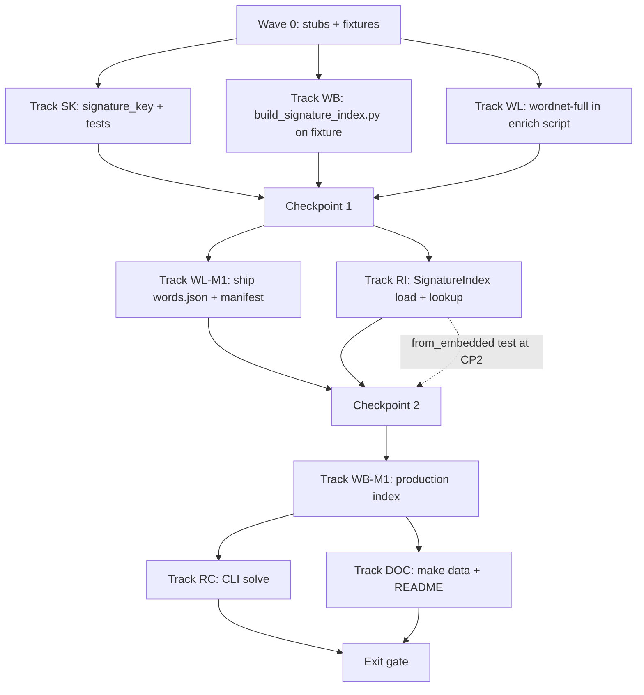

# Signature Index & Expanded Lexicon — Implementation Runbook

**Spec:** [SPEC_SIGNATURE_INDEX.md](./SPEC_SIGNATURE_INDEX.md) (v1.2)  
**Parent project:** [RUNBOOK.md](./RUNBOOK.md), [SPEC.md](./SPEC.md)  
**Goal:** Implement lexicon expansion (WordNet `wordnet-full`), durable `signature_index.json`, Rust load/lookup, and `anagram solve` CLI (SPEC §7.2) — using **parallel subagents** where files do not overlap.

**Note:** Default game flow stays `anagram` (TUI). `solve` is a **clap subcommand** added in Track RC without breaking existing flags (`--config`, `--word`, `--plain`).

---

## Infrastructure (current repo)

| Item | Status |
|------|--------|
| `data/words.json` | **58,157** entries; **`wordnet-full`** (M1, WL-M1) |
| `scripts/enrich_wordnet.py` | **`common`** + **`wordnet-full`** modes |
| `data/signature_index.json` | **Not present** (W0 adds §5.2 placeholder) |
| `data/fixtures/` | **Not present** (W0 adds `words_mini.json`) |
| `src/signature_index.rs` | **Not present** (W0 adds module stub) |
| Tests | `cargo test` green on main game; index tests to add |

**Prerequisites**

- Rust ≥ 1.75, `cargo test` from repo root
- Python 3.10+ for data scripts
- WordNet 3.0+ unpacked to a known path (default in script: `/tmp/wn/dict` or `WN_DIR` env)
- Disk: allow **~50–150 MB** git objects after M1 `words.json` + index land

---

## How to use this runbook

1. Complete **Wave 0** (one owner) — module stub, fixture data, compile gate.
2. **Wave 1 — parallel (max 3 agents):** **WL** (lexicon script), **WB** (index builder on fixture), **SK** (signature key Rust + tests).
3. **Checkpoint 1 (CP1)** — SK + WB + WL merged; fixture index on disk; `cargo test` green (**signature_key tests only** — lookup tests come with RI).
4. **Wave 2 — parallel (max 2):** **WL-M1** (full `words.json` + manifest + attribution), **RI** (`SignatureIndex` load/lookup tests using **fixture** JSON via `from_str`, not `from_embedded` yet).
5. **Checkpoint 2 (CP2)** — sequential: **WB-M1** production index; **WL-M1** entry-count gate; **RI** production `from_embedded` test + load smoke (§12.4).
6. **Wave 3 — parallel (max 2), only after CP2:** **RC** (`solve` CLI), **DOC** (`make data`, README).
7. **Exit gate** — SPEC §12 acceptance criteria.

**Agent tip:** Spawn **WL + WB + SK** after Wave 0. Do **not** run **WB-M1** until **WL-M1** has written `data/words.json`. **RI** can start on fixture index during Wave 2 in parallel with **WL-M1**.

---

## Dependency overview



---

## Wave 0 — Contracts (sequential, ~30 min)

**Owner:** one worker. **Does not** regenerate full WordNet data.

| Step | Task | Artifact |
|------|------|----------|
| 0.1 | `src/lib.rs`: `pub mod signature_index;` (optional `pub use` for types) | `lib.rs` |
| 0.2 | Create `src/signature_index.rs`: public types + stub fns (`signature_key`, `from_embedded`, `lookup`) that compile but `panic!` or `todo!()` if called (replaced in SK / RI) | `signature_index.rs` |
| 0.3 | Add `data/fixtures/words_mini.json` (JSON **array** like production `words.json`; ≥3 entries; **must** include an anagram pair e.g. `listen` + `silent` with non-empty `definition`) | fixture |
| 0.4 | Add **placeholder** `data/signature_index.json` — valid §5.2 schema, empty or single-bucket (replaced entirely at CP2 by WB-M1) | placeholder only |
| 0.5 | `cargo build` green | — |

**Done when:** crate compiles; **no** WordNet download; **no** implementation of key derivation or JSON parse (Track SK / RI).

**Prompt pack:** “Wave 0 only: module stub + fixtures + placeholder `data/signature_index.json`. Do not implement `signature_key` or Serde load.”

---

## Wave 1 — Parallel tracks

### Track SK — Signature key (Rust)

**Scope:** `src/signature_index.rs` — implement `signature_key`, `Signature`, `signature_from_str`, `SignatureError` only.  
**Does not touch:** `scripts/*`, `data/words.json`, `from_embedded`, `lookup`, `lib.rs` (unless fixing unused warnings).

| Task | Detail |
|------|--------|
| SK.1 | Implement §3.2 / Appendix B (`signature_key` sorted string) |
| SK.2 | `SignatureError` for empty / non-`a`–`z` |
| SK.3 | Unit tests: `INDIA`→`adiin`; `listen`/`silent` same key; invalid input |

**Done when:** `cargo test signature_key` passes without full index loader.

**Prompt pack:** “SPEC_SIGNATURE_INDEX §3.2 + §9 signature_key tests only in `signature_index.rs`.”

---

### Track WB — Index builder (Python)

**Scope:** `scripts/build_signature_index.py`, optional `requirements-data.txt` if needed (stdlib only preferred).  
**Does not touch:** `src/*`, `data/words.json` (use `--input data/fixtures/words_mini.json` only).

| Task | Detail |
|------|--------|
| WB.1 | CLI: `--input`, `--output`, `--min-len`, `--max-len`; input = **`words.json` array** (`[{word, definition}, …]`), same as production |
| WB.2 | Dedupe by lowercase word; sort bucket entries by `word` |
| WB.3 | Emit §5.2 JSON (`format_version`, `source.sha256`, stats, `buckets`) |
| WB.4 | Keys = `signature_string` (call shared logic or duplicate Appendix B in Python) |
| WB.5 | Run on `data/fixtures/words_mini.json` → `data/fixtures/signature_index_mini.json` |
| WB.6 | Print `entry_count`, `bucket_count`, `max_bucket_size` |
| WB.7 | Optional `--print-key WORD` for CP1 golden check against Rust |

**Done when:** fixture index builds deterministically; second run identical sha256.

**Prompt pack:** “Implement `build_signature_index.py` per SPEC §4–5. Test on `words_mini.json` only.”

---

### Track WL — Lexicon script (Python)

**Scope:** `scripts/enrich_wordnet.py` (add flags; keep default behavior = today’s pipeline until `--mode` is passed).  
**Does not touch:** `src/signature_index.rs`, `data/words.json`, `data/ATTRIBUTION.md` (attribution lands in **WL-M1**).

| Task | Detail |
|------|--------|
| WL.1 | Add `--mode common|wordnet-full` per §10.5 |
| WL.2 | `wordnet-full`: all single-token alphabetic lemmas in `min_len..=max_len` with gloss |
| WL.3 | Remove **required** allowlist intersection in `wordnet-full` |
| WL.4 | `--emit-manifest PATH` — Wave 1 MUST use **`/tmp/anagram_words_preview.manifest.json`** (not `data/words.manifest.json`) |
| WL.5 | `WN_DIR` env overrides hardcoded dict path (default `/tmp/wn/dict`); document WordNet download in script header |
| WL.6 | `--output PATH` (default `data/words.json`); Wave 1 MUST use **`/tmp/anagram_words_preview.json`** only |

**Done when:** `python scripts/enrich_wordnet.py --mode wordnet-full --output /tmp/anagram_words_preview.json` reports entry count; **no args** or `--mode common` still reproduces current `data/words.json` behavior (~5k).

**Status (WL complete):** Preview `wordnet-full` → **58,157** glossed entries (`/tmp/anagram_words_preview.json`, manifest `/tmp/anagram_words_preview.manifest.json`). `common` regression → **5,249** entries (matches committed `data/words.json`). Tasks WL.1–WL.6 implemented in `scripts/enrich_wordnet.py`; `data/words.json` unchanged in this track.

**Prompt pack:** “§10 wordnet-full mode + manifest; do not commit multi-MiB `words.json` in this track.”

---

## Checkpoint 1 (~15 min, sequential)

- [ ] SK merged: `signature_key` / `signature_from_str` tests pass (`cargo test signature`)  
- [ ] WB merged: `data/fixtures/signature_index_mini.json` committed (built from `words_mini.json`)  
- [ ] WL merged: `wordnet-full` preview build succeeds (count logged; **do not** replace `data/words.json` yet)  
- [ ] Golden key check: `build_signature_index.py --print-key` matches Rust for fixture words (WB.7)  
- [ ] `cargo test` green (game tests unchanged; **no** `from_embedded` tests required yet)

---

## Wave 2 — Parallel tracks

### Track WL-M1 — Production lexicon

**Scope:** `data/words.json`, `data/words.manifest.json`, `data/ATTRIBUTION.md`, `docs/` one-liner if needed.  
**Depends on:** CP1 WL script on disk.

| Task | Detail |
|------|--------|
| WL-M1.1 | `python scripts/enrich_wordnet.py --mode wordnet-full --emit-manifest data/words.manifest.json --output data/words.json` → commit outputs |
| WL-M1.2 | Verify `entry_count` vs M1 (§10.3); set `min_entries_required` in manifest; if count < 35k, follow spec §13.6 before release |
| WL-M1.3 | `Dictionary::from_embedded` still parses (benchmark load if slow) |
| WL-M1.4 | Add `data/ATTRIBUTION.md` citing WordNet |

**Done when:** manifest + attribution committed; `cargo test` dictionary tests pass (adjust counts if tests assumed ~5k only in dedicated tests).

**Prompt pack:** “Produce M1 `words.json` + manifest + ATTRIBUTION; fix any dictionary tests broken by scale.”

**Status (WL-M1 complete):** `wordnet-full` → **58,157** glossed entries (`data/words.json`, `data/words.manifest.json`, `min_entries_required` 35000). `data/ATTRIBUTION.md` added. M1 gate (≥35k) **met**. `cargo test` green (56 tests); dictionary tests unchanged (no hardcoded ~5k assertions).

---

### Track RI — Index loader (Rust)

**Scope:** `src/signature_index.rs` (Serde structs, `from_embedded`, `lookup`).  
**Does not touch:** `data/words.json`, enrich scripts.

| Task | Detail |
|------|--------|
| RI.1 | Deserialize §5.2; `SignatureIndex::from_embedded()` |
| RI.2 | `lookup(scramble)` → `LookupResult` (§6.2) |
| RI.3 | `source.sha256` check vs bundled `words.json`: implement in loader but **enable in tests only after CP2** (placeholder index will mismatch until WB-M1) |
| RI.4 | `SignatureIndex::from_str` / `from_reader` for tests reading `data/fixtures/signature_index_mini.json` |
| RI.5 | `from_embedded()` implemented using `include_str!(.../data/signature_index.json)` but tests **must not** depend on placeholder content until CP2 |
| RI.6 | Ambiguous-bucket test: fixture pair sharing `eilnst` (§12.6) |

**Does not touch:** `cli.rs`, `lib.rs::run` TUI loop (RC owns dispatch).

**Done when:** lookup tests pass via fixture path; `from_embedded` compiles.

**Prompt pack:** “§6 load + lookup; §9 tests; fixture file on disk; leave production `data/signature_index.json` as placeholder until CP2.”

---

## Checkpoint 2 (~20 min, sequential)

- [ ] `data/words.json` at M1 scale on disk  
- [ ] **WB-M1:** `python scripts/build_signature_index.py --input data/words.json --output data/signature_index.json`  
- [ ] Index top-level includes `index_bytes` (file size) per §10.7; `source.sha256` matches `data/words.json`  
- [ ] `entry_count` / `bucket_count` consistent with `data/words.manifest.json`  
- [ ] RI (CP2): `from_embedded` integration test against committed production index; sha256 check on; load smoke < 500 ms (§12.4)  
- [ ] `ANAGRAM_LEXICON_MIN_ENTRIES` (default `35000`) satisfied or manifest documents §13.6 exception  
- [ ] `cargo test` full suite green  

**WB-M1 prompt:** “Build production `data/signature_index.json` from committed `words.json`; commit artifact per spec §13.2.”

---

## Wave 3 — Parallel tracks

### Track RC — CLI `solve`

**Scope:** `src/cli.rs`, `src/lib.rs` (`run` dispatch only), optional `src/solve.rs` helper.  
**Depends on:** CP2 (`SignatureIndex::from_embedded` + production index).

| Task | Detail |
|------|--------|
| RC.1 | Refactor `Cli` to optional clap **subcommands**: **no subcommand** (or `play`) → existing TUI; **`solve SCRAMBLE`** → stdout only |
| RC.2 | Root-global: `--config`, `--plain`. Play-only: `--word` (same semantics as today; e.g. `anagram --word plum` or `anagram play --word plum`) |
| RC.3 | `solve`: normalize scramble → `lookup`; **normative output:** TSV `word<TAB>definition` per line (§7.2) |
| RC.4 | Exit codes: `0` ≥1 match, `1` no match, `2` invalid input (`SignatureError`) |
| RC.5 | Unit tests: clap parse `solve eilnst`; no ratatui in solve path |

**Does not touch:** `ui.rs`, `app.rs` (no TUI scramble mode in this runbook).

---

### Track DOC — Developer workflow

**Scope:** `Makefile` or `justfile`, `README.md`, cross-link [RUNBOOK.md](./RUNBOOK.md).

| Task | Detail |
|------|--------|
| DOC.1 | `Makefile` target `data`: `enrich_wordnet.py --mode wordnet-full --emit-manifest data/words.manifest.json --output data/words.json` then `build_signature_index.py --input data/words.json --output data/signature_index.json`; gate on `ANAGRAM_LEXICON_MIN_ENTRIES` |
| DOC.2 | Document `WN_DIR`, WordNet download, `ANAGRAM_LEXICON_MIN_ENTRIES` (default 35000 until spec §13.6 adjustment) |
| DOC.3 | Link from main [RUNBOOK.md](./RUNBOOK.md) §Data (add subsection; do not duplicate full TUI waves) |

---

## Exit gate

```bash
# Data (when WordNet available)
make data   # or documented two-step scripts
test -f data/words.manifest.json
test -f data/signature_index.json

# Rust
cargo test
cargo build --release
cargo run -- solve eilnst    # TSV lines if listen/silent in lexicon
cargo run -- solve zzzzzz   # exit 1 (no match; valid a-z)
cargo run --                # TUI still works
```

**SPEC §12 checklist**

- [ ] 1. `wordnet-full` + M1 `entry_count`  
- [ ] 2. `data/ATTRIBUTION.md`  
- [ ] 3. Scripted index build  
- [ ] 4. Load smoke < 500 ms (log in test or manual)  
- [ ] 5. Lookup correctness  
- [ ] 6. Ambiguous-bucket fixture test  
- [ ] 7. This runbook accurate  

**Out of scope for this runbook (SPEC §7):**

- TUI scramble-only mode (v2)  
- SQLite / mmap (until index > ~50 MiB on disk)  

---

## Parallelization matrix

| After | Parallel tracks | Max agents |
|-------|-----------------|------------|
| Wave 0 | — (sequential) | 1 |
| Wave 1 | SK, WB, WL | 3 |
| CP1 | — (sequential) | 1 |
| Wave 2 | WL-M1, RI | 2 |
| CP2 | WB-M1 + RI production tests (sequential, blocks Wave 3) | 1 |
| After CP2 | RC, DOC | 2 |

**Wall-clock estimate (3 agents):** W0 30m + W1 45m + CP1 15m + W2 60–90m (WL-M1 dominates) + CP2 20m + W3 30m → **~4h** including WordNet I/O.

---

## File ownership (merge conflict avoidance)

| Path | Owner |
|------|--------|
| `src/signature_index.rs` | W0 (shell); SK (§key); RI (load/lookup) — **one agent per wave** |
| `src/lib.rs` | W0 (`mod`); RC only for `run()` subcommand dispatch |
| `src/cli.rs` | RC only (subcommand refactor) |
| `src/solve.rs` | RC optional |
| `data/signature_index.json` | W0 placeholder; **WB-M1 replaces** at CP2 (no other tracks) |
| `src/dictionary.rs` | WL-M1 only if load/perf fixes needed |
| `scripts/enrich_wordnet.py` | WL / WL-M1 |
| `scripts/build_signature_index.py` | WB / WB-M1 |
| `data/words.json` | WL-M1 only |
| `data/fixtures/*` | W0 (`words_mini.json`); WB (`signature_index_mini.json`) |
| `data/ATTRIBUTION.md`, `data/words.manifest.json` | WL-M1 |
| `Makefile`, `README.md` | DOC |
| `docs/SPEC_SIGNATURE_INDEX.md` | Human / lead agent at CP1 if behavior changes |

**Rules:**

- Only **one** agent edits `src/signature_index.rs` per wave (W0 → SK → RI).  
- **WL** and **WL-M1** must not commit preview paths into `data/words.json` until WL-M1.  
- **`data/signature_index.json`:** W0 placeholder only; production content **only** via WB-M1 at CP2.  
- **`data/words.manifest.json`:** written only in **WL-M1** (not WL preview).

---

## Risk register

| Risk | Mitigation |
|------|------------|
| M1 count < 35k | §10.3 + spec §13.6; lower gate with documented manifest |
| Huge git diff | Optional Git LFS later; for v1 accept large commit |
| `Dictionary` load slow on 80k words | Benchmark in WL-M1; defer index parse to `signature_index` only |
| SK vs RI conflict on same file | Serialize SK → CP1 → RI |
| WordNet missing on CI | CI uses committed `data/words.json` + `data/signature_index.json`; `make data` optional; script tests use `data/fixtures/*` only |
| WL-M1 slow / huge commit | Single commit; expected; benchmark `Dictionary::from_embedded` in WL-M1.3 |
| Duplicate logic Python/Rust key | Golden test: script prints key for fixture words; Rust tests same vectors |
| RC breaks flat `Cli` / `--word` | Subcommand at root; keep `--word` on play path only; update any clap tests |

---

## Track checklist (copy for board)

```
[x] W0  Stubs + fixtures
[x] SK  signature_key + tests
[ ] WB  build_signature_index.py (fixture)
[x] WL  wordnet-full script
[ ] CP1
[x] WL-M1  words.json + manifest + ATTRIBUTION
[x] RI   SignatureIndex load/lookup + tests
[ ] CP2  WB-M1 production index
[ ] RC   CLI solve
[ ] DOC  make data + README
[ ] Exit gate
```

---

## Subagent prompt templates

**W0:**  
`Full Repository Path: /Users/vijay/work/anagram. Track W0 only in RUNBOOK_SIGNATURE_INDEX.md. lib.rs mod stub, placeholder data/signature_index.json (§5.2), data/fixtures/words_mini.json with listen+silent. No signature_key impl.`

**SK:**  
`Full Repository Path: /Users/vijay/work/anagram. Implement Track SK in docs/RUNBOOK_SIGNATURE_INDEX.md. SPEC: docs/SPEC_SIGNATURE_INDEX.md v1.2 §3.2, §9. Files: src/signature_index.rs only. Do not implement JSON load.`

**WB:**  
`… Track WB. Scripts only + data/fixtures/signature_index_mini.json. SPEC §4–5.`

**WL:**  
`… Track WL. --mode wordnet-full; output /tmp/anagram_words_preview.json only; manifest to /tmp. Do not touch data/words.json.`

**WL-M1:**  
`… Track WL-M1. Commit data/words.json at M1, manifest, ATTRIBUTION. Fix dictionary tests if needed.`

**RI:**  
`… Track RI after CP1. from_str fixture tests + stub from_embedded. Defer sha256 + production from_embedded test to CP2. SK merged.`

**RC:**  
`… Track RC. clap subcommand solve + lib.rs run() dispatch. §7.2 TSV stdout. After CP2. Preserve default TUI.`

**WB-M1:**  
`… Track WB-M1 at CP2. Build data/signature_index.json from data/words.json; replace W0 placeholder. Record index_bytes + sha256.`

**DOC:**  
`… Track DOC. Makefile data target + README + RUNBOOK.md cross-link.`