# UI Desktop — Implementation Runbook

**Spec:** [SPEC-ui.md](SPEC-ui.md) (Draft v1, source of truth for the GUI)  
**Parent specs:** [SPEC.md](SPEC.md) (TUI rules, unchanged), [wireframe-ui.html](wireframe-ui.html) (visual reference)  
**Related runbooks:** [RUNBOOK.md](RUNBOOK.md), [RUNBOOK_LETTER_WORKBENCH.md](RUNBOOK_LETTER_WORKBENCH.md), [RUNBOOK_SIGNATURE_INDEX.md](RUNBOOK_SIGNATURE_INDEX.md)  
**Goal:** Build the Tauri v2 desktop front end in parallel subagent waves, with exclusive file ownership per work package.  
**Repo:** `/Users/vijay/git/personal/anagram` · **Branch:** `ui-design-docs` · **Never touch `main`.**

---

## 1. Purpose & Scope

### 1.1 Purpose

- Implement [SPEC-ui.md](SPEC-ui.md) §1–§10: a macOS-first Tauri app with Rust backend in `src-tauri/` and TypeScript frontend in `ui-web/`.
- Reuse the core crate (`app::reduce`, `game`, `dictionary`, `signature_index`, `workbench`, `affix_hints`, `config`). The GUI adds IPC DTOs and presentation only.
- This runbook assigns spec sections to work packages (WPs). It does not restate game rules; those live in [SPEC.md](SPEC.md) §3–§4.4.

### 1.2 Non-regression

- `make test` (= `cargo test`, root crate via `default-members`) must stay green. Baseline on `ui-design-docs` @ `13c628a` (code identical to `72261f0`): **108 passed, 0 failed** (observed 2026-11-23). Test count may only grow.
- TUI behavior must not change: `cargo run --` and `cargo build --release` at root.
- Core edits are allowed only in WP-1: additive (D-7), plus the D-6 identity guard in `workbench.rs`, the only intended TUI-visible change.

### 1.3 Preflight (orchestrator, once)

| Check | Command | Observed 2026-11-23 |
|-------|---------|---------------------|
| Branch | `git -C $REPO branch --show-current` | `ui-design-docs` |
| Clean tree | `timeout 10 git -C $REPO status --short` | empty |
| Timeout tool | `command -v gtimeout` | `/opt/homebrew/bin/gtimeout` (`timeout` is an alias to it in the user's shell; if `timeout` is not found, use `gtimeout`) |
| Rust | `cargo --version` | 1.95.0 (Tauri 2.x needs ≥ 1.90) |
| Node / npm | `node --version && npm --version` | v26.4.0 / 11.17.0 |
| Baseline | `timeout 900 make test` | 108 passed |
| Tauri CLI | `cargo tauri --version` | **not installed** → step P-1 |

Set once per shell: `REPO=/Users/vijay/git/personal/anagram`

**P-1 — Install Tauri CLI:** `timeout 1800 cargo install tauri-cli --version "^2" --locked`  
Why this method (D-11): SPEC-ui §9 mandates `cargo tauri dev|build`. The npm package `@tauri-apps/cli` installs a `tauri` binary, not `cargo tauri`. `^2` resolves to 2.x (crates.io newest is 3.0.0-alpha.6, pre-release excluded). `--locked` pins the CLI's dependency set.  
Verify: `timeout 30 cargo tauri --version` prints `2.x.y`.

### 1.4 Resolved decisions

Spec gaps and ambiguities are resolved here. Subagents apply these without escalation.

| ID | Decision | Basis |
|----|----------|-------|
| D-1 | Click workbench pool tile while holding a tile → no-op | Spec silent; smallest change |
| D-2 | Click empty workbench cell with empty hand → no-op | Spec silent |
| D-3 | Workbench Layout B (sparse grid); 5×5 default, 4×4 via config | SPEC-ui §3.4.1, Q5 default |
| D-4 | Effective bounds = config `[min_size, max_size]` ∩ `[4, 10]`. `Session` uses them for `GameState::with_bounds`, clamps `selectSize` to them, and `UiState.min_size`/`max_size` report them. `lo > hi` → startup error | Core `reduce_select_size` clamps to fixed 4..=10 (`app.rs` `SIZE_MIN`/`SIZE_MAX`). Without the intersection, `max_size = 12` shows slider 12 and plays length 10. Spec-vs-code conflict: SPEC-ui §3.1 does not cover out-of-range config. TUI unchanged |
| D-5 | Startup fails (native dialog) if any length in the effective range (D-4) has no dictionary word | Prevents dead slider positions |
| D-6 | Workbench shuffles avoid identity order (same rule as SPEC.md §5.2) | `LetterWorkbench::from_solution` and `reset_grid` have no guard; `Round::new` does |
| D-7 | Core change is additive: 4 `Action` variants, 2 workbench methods. No signature change. The only TUI-visible change is D-6 | Resolves SPEC-ui §2/§5.2 ("API unchanged") vs §5.4 ("no app::Action equivalent yet") |
| D-8 | Confirm dialog gates only phases `playing` and `help`; `won` never confirms | SPEC-ui §3.1, Q6 |
| D-9 | `cancelCustomWord` maps to `[CancelCustomWord, NewPuzzle]`; `Session` no-ops it outside custom phases | SPEC-ui §3.1 |
| D-10 | `tauri-plugin-dialog` used from Rust only (startup errors). No JS dialog permission | SPEC-ui §4.3 (native dialog; frontend gets no plugin permissions) |
| D-11 | Tauri CLI via `cargo install tauri-cli --version "^2" --locked` | SPEC-ui §9 |
| D-12 | DTO module lives in `src-tauri/src/dto.rs`, not in the core crate | SPEC-ui §4.1, §5.2 (core types must not derive `Serialize`) |
| D-13 | Q2 (`tui` Cargo feature gate) not implemented in v1 | SPEC-ui §11 Q2 is optional; avoids touching root `lib.rs`, `ui.rs`, `input.rs`, `terminal.rs` |
| D-14 | Tauri dependency `tauri = "2"`; `src-tauri` `rust-version` = MSRV of the resolved Tauri 2.x (1.90 observed) | `cargo info tauri@2`. Root crate stays at `1.75` |
| D-15 | `ui-web` IPC dispatches are queued FIFO | Focus-then-click pairs must apply in order |
| D-16 | Q1, Q3, Q4, Q5 (B), Q6, Q7, Q8 use SPEC-ui §11 defaults; Q2 is not built (D-13) | No escalation |
| D-17 | Two modules outside the SPEC-ui §4.1 tree: `src-tauri/src/lib.rs` (module root; lets `tests/` import the crate) and `src-tauri/src/session.rs` (`Engine`, `Session`, `AppState`). `main.rs` holds only the Tauri builder | SPEC-ui §4.3 names `Session` but not its file. Binary-only crates cannot be imported by `tests/` |
| D-18 | `dispatch` and `get_state` return `Result<UiState, String>`; `Err` on invalid letter or poisoned lock. `ActionDto::into_actions() -> Result<Vec<Action>, DtoError>` replaces `TryFrom<ActionDto> for Action`, because `cancelCustomWord` maps to two actions | SPEC-ui §4.3 (`-> UiState`), §5.4 (`TryFrom`); spec-vs-code conflict |

---

## 2. Global Rules (every subagent)

1. **Ownership.** Edit only files listed under *Owned* in your WP. Read anything. If you need a change elsewhere, report it (§5.4). Do not edit it.
2. **Read-before-write, reread-after-write.** Read each owned file before editing. Reread it after writing and confirm the change landed.
3. **Timeouts.** Wrap every command: `timeout <seconds> <cmd>`. Use `--locked` on cargo commands once WP-0 is merged. Use `npm ci` (not `install`) in worktrees once `ui-web/package-lock.json` exists.
4. **Git.** No commits to `main`. No `push`. No `checkout main`, `reset --hard`, `rebase`, `force`. Commit only your owned files, only on your own branch `ui/wp-<N>` in your worktree, with message `UI WP-<N>: <title>`.
5. **No extra artifacts.** No new docs, notes, logs, or screenshots in the repo. Do not edit `SPEC-ui.md`, `SPEC.md`, any `RUNBOOK*.md`, or `Makefile`.
6. **Compile-safe steps.** Keep owned Rust files compiling at every step. Unfinished bodies may use `todo!()` only if your acceptance criteria do not need them.
7. **Spec precedence.** `SPEC-ui.md` first, then §1.4 decisions. If neither covers a case, choose the smallest change consistent with the spec and record it as ⚠️.
8. **No nested subagents.** Never override `HOME` without also pinning `CARGO_HOME` and `RUSTUP_HOME` to the real home.
9. **Report format (≤ 12 lines), exactly:**
   ```
   WP-<N> <title> — ✅ | ⚠️ | 🚧
   Files: <paths>
   Commands: <cmd> → exit <code> (<key output>)
   Decisions applied: <D-ids or none>
   Open items: <NEED/CONTRACT lines or none>
   ```
   Legend: ✅ success · ⚠️ self-corrected issue · 🚧 blocked (only when the WP cannot meet acceptance even with §1.4 decisions).

---

## 3. Dependency Graph & Waves

```mermaid
flowchart LR
  W0[Wave 0: WP-0 shells, WP-1 core actions] --> W1
  subgraph W1[Wave 1 parallel ×5]
    WP2[WP-2 dto.rs]
    WP3[WP-3 session.rs]
    WP4[WP-4 Tauri shell]
    WP5[WP-5 theme.rs]
    WP6[WP-6 ui-web scaffold]
  end
  W1 --> W2
  subgraph W2[Wave 2 parallel ×4]
    WP7[WP-7 play render]
    WP8[WP-8 keyboard input]
    WP9[WP-9 overlays]
    WP10[WP-10 workbench]
  end
  W2 --> W3
  subgraph W3[Wave 3 parallel ×3]
    WP11[WP-11 Rust integration]
    WP12[WP-12 theme CSS]
    WP13[WP-13 accessibility]
  end
  W3 --> W4[Wave 4 serial: WP-14 integration]
```



| Wave | WPs | Mode | Depends on | Gate |
|------|-----|------|------------|------|
| 0 | WP-0 → WP-1 | Serial, orchestrator, branch `ui-design-docs` | — | G0 |
| 1 | WP-2, WP-3, WP-4, WP-5, WP-6 | Parallel (5 worktrees) | Wave 0 merged | G1 |
| 2 | WP-7, WP-8, WP-9, WP-10 | Parallel (4 worktrees) | Wave 1 merged | G2 |
| 3 | WP-11, WP-12, WP-13 | Parallel (3 worktrees) | Wave 2 merged | G3 |
| 4 | WP-14 | Serial, orchestrator | Wave 3 merged | G4 |

Wave 0 creates compiling shells for every Rust contract, so all Wave 1 Rust WPs can run in parallel against the shells. Wave 2 UI WPs use the TypeScript stubs from WP-6 and the `?fixture=` dev route, so they do not need the Rust backend running.

---

## 4. Work Package Specs

### 4.0 Subagent prompt template (copy-paste, fill `N`)

```
You are subagent WP-{N} for the anagram repo (Tauri desktop UI).
Worktree: /Users/vijay/git/personal/anagram-wt/wp-{N}   Branch: ui/wp-{N}
1. Read docs/RUNBOOK_UI.md §2 (Global Rules) and §4 "WP-{N}" in full.
2. Read the SPEC-ui.md sections listed under "Inputs" for WP-{N}.
3. Edit ONLY the "Owned" files for WP-{N}. Read each file before and after editing.
4. Meet every acceptance criterion. Run the Verify commands, each wrapped in timeout.
5. Commit owned files on ui/wp-{N} as "UI WP-{N}: <title>". Do not push. Do not touch main.
6. Reply with the §2 item 9 report only.
```

Orchestrator creates the worktree first (§5.1).

---

### WP-0 — Workspace conversion and frozen Rust contracts

- **Wave:** 0 · serial · orchestrator, main worktree, branch `ui-design-docs`
- **Goal:** Make the repo a Cargo workspace. Create compiling shells for every Rust contract so Wave 1 can run in parallel.
- **Inputs:** SPEC-ui §4.1, §4.2, §4.3, §5.3, §5.4
- **Owned:** `Cargo.toml`, `Cargo.lock` (cargo-generated only), `src-tauri/Cargo.toml` (shell; WP-4 is sole owner from Wave 1), `src-tauri/src/lib.rs`, `src-tauri/src/main.rs`, `src-tauri/src/dto.rs`, `src-tauri/src/session.rs`, `src-tauri/src/theme.rs`

**Steps**

1. Append to root `Cargo.toml` (leave `[package]` unchanged, including `rust-version = "1.75"`):
   ```toml
   [workspace]
   members = [".", "src-tauri"]
   default-members = ["."]
   resolver = "2"
   ```
2. `src-tauri/Cargo.toml` (shell; WP-4 adds Tauri):
   ```toml
   [package]
   name = "anagram-desktop"
   version = "0.1.0"
   edition = "2021"
   rust-version = "1.90"
   description = "Tauri desktop front end for the anagram core"

   [dependencies]
   anagram = { path = ".." }
   anyhow = "1"
   rand = { version = "0.8", features = ["std_rng"] }
   ratatui = { version = "0.29", default-features = false }
   serde = { version = "1", features = ["derive"] }
   serde_json = "1"
   ```
3. `src-tauri/src/lib.rs` shell: `pub mod dto; pub mod session; pub mod theme;` (no Tauri code). `src-tauri/src/main.rs` shell: `fn main() {}`. `tauri::generate_context!` goes in `main.rs` only (WP-4), so Waves 0–2 build without `ui-web/dist`.
4. `src-tauri/src/dto.rs` shell. Copy the types from SPEC-ui §5.3 and §5.4 with these exact names and serde attributes:
   - `UiState`, `PhaseDto` (`CustomWordInput, CustomWordPick, Playing, Help, Won`), `ClueDto { used, budget }`, `StatusDto { kind: StatusKind, message: Option<String> }`, `StatusKind` (`None, Error, Info, WrongAnswer`), `RoundDto`, `WorkbenchDto`, `LayoutDto` (`Grid, Free`), `PlacedDto { ch, x, y }`, `FocusDto` (`Answer, Grid`), `AffixDto { starts, ends }`, `CustomDto { input, choices, pick }`, `ChoiceDto { word, definition }`, `ThemeDto { empty_slot, filled_slot, pool, correct_position: String }`.
   - Output types: `#[derive(Serialize)]` and `#[serde(rename_all = "camelCase")]`. `ActionDto` and every type it contains (including `FocusDto`) derive `Deserialize`. Core types get no serde derives.
   - `ActionDto`: `#[derive(Deserialize)] #[serde(tag = "type", rename_all = "camelCase")]` with variants `ToggleHelp, NewPuzzle, ResetRound, RequestClue, Backspace, CursorLeft, CursorRight, TypeLetter { ch: char }, SelectSize { n: u8 }, OpenCustomWord, CustomWordType { ch: char }, CustomWordBackspace, SubmitCustomWord, CancelCustomWord, CustomPickDelta { delta: i32 }, CustomPickSelect { idx: usize }, ConfirmCustomPick, WorkbenchClickCell { idx: usize }, WorkbenchClickPool { idx: usize }, WorkbenchSetFocus { focus: FocusDto }, WorkbenchClear`.
   - `pub enum DtoError { InvalidLetter(char) }`
   - Functions (bodies `todo!()`):
     - `pub fn ui_state(state: &GameState, affix: Option<&AffixHints>, theme: &ThemeDto) -> UiState`
     - `impl ActionDto { pub fn into_actions(self) -> Result<Vec<Action>, DtoError> }`
5. `src-tauri/src/session.rs` shell:
   - `pub struct Engine { pub dict: Dictionary, pub index: SignatureIndex, pub theme: ThemeDto }` with `pub fn load(config: &AppConfig) -> anyhow::Result<Self>`
   - `pub struct Session { pub state: GameState, pub rng: StdRng, pub affix_cache: Option<(String, AffixHints)> }` with:
     - `pub fn new(engine: &Engine, config: &AppConfig) -> anyhow::Result<Self>`
     - `pub fn new_seeded(engine: &Engine, config: &AppConfig, seed: u64) -> anyhow::Result<Self>`
     - `pub fn dispatch(&mut self, engine: &Engine, action: ActionDto) -> Result<UiState, String>`
     - `pub fn snapshot(&mut self, engine: &Engine) -> UiState`
   - `pub struct AppState { pub engine: std::sync::Arc<Engine>, pub session: std::sync::Mutex<Session> }`. `Engine` is read-only, so it has no lock (SPEC-ui §4.3).
6. `src-tauri/src/theme.rs` shell: `pub fn theme_dto(config: &AppConfig) -> ThemeDto` and `pub fn color_to_css(c: ratatui::style::Color) -> &'static str` (bodies `todo!()`).

**Acceptance**

- `cargo metadata` lists two workspace members (`anagram`, `anagram-desktop`).
- Root `cargo test` still reports 108 passed.
- `cargo test --workspace` compiles (shell warnings allowed).
- `Cargo.lock` diff adds only the `anagram-desktop` package entry. No other version changes.
- `rg -n 'Serialize' src/` prints nothing (core types derive no `Serialize`).

**Verify**

```bash
timeout 120 cargo metadata --format-version 1 --no-deps >/dev/null && echo META_OK
timeout 900 cargo test --locked 2>&1 | tail -n 5
timeout 900 cargo test --workspace --locked --no-run 2>&1 | tail -n 3
timeout 10 git -C $REPO diff -- Cargo.lock | rg '^[+-]' | head -n 20
```

---

### WP-1 — Core additive actions (workbench pointer + custom pick)

- **Wave:** 0 · serial · orchestrator, after WP-0
- **Goal:** Add the minimum core actions required by SPEC-ui §5.4 pointer variants and fix the workbench identity shuffle (D-6). TUI behavior changes only by the D-6 identity guard.
- **Inputs:** SPEC-ui §3.1 (custom pick), §3.4, §3.4.1 (Layout B), §3.6 (pointer table), §5.4; SPEC.md §5.2 (identity avoidance)
- **Owned:** `src/app.rs`, `src/workbench.rs` (non-test code and their `#[cfg(test)]` modules)

**Changes**

1. `app::Action` (add variants, keep all existing):
   - `CustomPickSelect(usize)`
   - `WorkbenchClickCell(usize)`
   - `WorkbenchClickPool(usize)`
   - `SetInputFocus(InputFocus)`
2. `reduce` arms:
   - `CustomPickSelect(i)`: only in `Phase::CustomWordPick` and `i < custom_word_choices.len()`. Sets `custom_word_pick = i`. Never starts a puzzle.
   - `WorkbenchClickCell(i)`: if `state.workbench` is `Some`, call `wb.click_cell(i)`.
   - `WorkbenchClickPool(i)`: if `state.workbench` is `Some`, call `wb.click_pool(i)`.
   - `SetInputFocus(f)`: set `state.input_focus = f`. Ignore `Grid` when `workbench` is `None`.
3. `workbench.rs` methods:
   - `pub fn click_cell(&mut self, idx: usize) -> bool`. Returns `false` if out of range. Otherwise sets `cursor = idx` and applies:
     - hand empty, cell empty → `false` (D-2)
     - hand empty, cell filled → pick up: `held = cell`, `cell = None`
     - hand filled, cell empty → place: `cell = held`, `held = None`
     - hand filled, cell filled → swap
   - `pub fn click_pool(&mut self, idx: usize) -> bool`. Returns `false` if `held.is_some()` (D-1) or `idx >= pool.len()`. Otherwise `held = Some(pool.remove(idx))`.
   - Both call `debug_assert_invariant` on success.
4. D-6: `from_solution` and `reset_grid` shuffle with an identity guard, same rule as `game::shuffle_pool_not_identity`. Implement a private copy in `workbench.rs`. Do not change `game.rs`.
5. Do not change existing signatures, `pick_place_swap` semantics, `input.rs`, `ui.rs`, `lib.rs`, or `game.rs`.

**Acceptance**

- Every existing test passes unmodified. `git diff` shows no changed or removed lines inside existing test functions.
- New tests cover:
  - `click_cell`: all four table rows, plus out-of-range
  - `click_pool`: pick, no-op while holding, out-of-range
  - `CustomPickSelect`: only in pick phase, bounded
  - `SetInputFocus`: sets focus; `Grid` ignored when no workbench
  - Invariant holds after a click sequence
  - Identity guard: for `"crate"`, 50 seeds, workbench pool ≠ `CRATE`
- `git diff --stat -- src/input.rs src/ui.rs src/lib.rs src/game.rs` is empty.

**Verify**

```bash
timeout 900 cargo test --locked 2>&1 | tail -n 5        # expect ≥108 passed, 0 failed
timeout 300 cargo test --locked workbench:: 2>&1 | tail -n 3
timeout 300 cargo test --locked app:: 2>&1 | tail -n 3
```

---

### WP-2 — DTO mapping (`dto.rs`)

- **Wave:** 1 · parallel
- **Goal:** Implement `ui_state`, `into_actions`, and the visibility rules. This is the only code that decides what crosses IPC.
- **Inputs:** SPEC-ui §5.1–§5.5, §3.1 (status text, custom pick), §3.3 (clue budget), §3.6 (action mapping)
- **Owned:** `src-tauri/src/dto.rs`

**Acceptance**

1. `ui_state` implements SPEC-ui §5.5 exactly:
   - `CustomWordInput` and `CustomWordPick`: `round = None`, `workbench = None`, `active_clue = None`, `clues = {used:0, budget:0}`.
   - `Playing`, `Help`, `Won`: `round` present without `solution` (except `Won`), `correct` present only when `highlight_correct_positions`, `workbench` present only when `state.workbench` is `Some`.
   - `custom.choices` is non-empty only in `CustomWordPick`, and contains only `word` and `definition`. Never `noun_senses`.
   - `workbench.affixes` is filled only when `affix` is `Some`. The Session passes `Some` only in `Playing`, `Help`, `Won`.
2. Phase mapping: `CustomWordInput`→`customWordInput`, `CustomWordPick`→`customWordPick`, `Playing`→`playing`, `Help`→`help`, `Won`→`won`. `Menu` and `SizeSelect` are never produced by the reducer in the GUI. Session returns `Err` if seen (WP-3).
3. Status mapping: `None`→`none`; `Error(m)`→`error`; `Info(m)`→`info`; `WrongAnswer`→`wrongAnswer` with message `"Not quite — check your letters."` (wording from `src/ui.rs`).
4. `ActionDto::into_actions`, 1:1 with SPEC-ui §5.4:
   - `CancelCustomWord` → `[CancelCustomWord, NewPuzzle]` (D-9)
   - `WorkbenchClear` → `[WorkbenchResetGrid]`
   - `WorkbenchSetFocus{focus}` → `[SetInputFocus(..)]`
   - `CustomPickSelect{idx}` → `[CustomPickSelect(idx)]`
   - `TypeLetter{ch}` / `CustomWordType{ch}` with non-ASCII-alphabetic `ch` → `Err(DtoError::InvalidLetter(ch))`
   - There is no Quit variant.
5. Wire format: camelCase keys (`helpOpen`, `activeClue`, `minSize`, `wrongAnswer`). `{"type":"typeLetter","ch":"a"}` deserializes.
6. Unit tests in `dto.rs` (`#[cfg(test)]`). Load `Dictionary::from_embedded()` and `SignatureIndex::from_embedded()`. Build states with `app::start_custom_word(GameState::new(5), word, ...)` (public):
   - `playing_hides_solution`: serialized JSON has no `"solution"` key and no solution string value
   - `won_exposes_solution`: `round.solution` equals the solution
   - `custom_phases_hide_round`
   - `pick_exposes_choices_only`
   - `correct_flags_follow_highlight`
   - `alternates_absent_outside_choices`: for `aliment` (alternate `ailment`), no `ailment` value in Playing JSON
   - `actions_map_one_to_one`
   - `non_letter_rejected`

**Verify**

```bash
timeout 1200 cargo test -p anagram-desktop --locked --lib dto:: 2>&1 | tail -n 15
```

---

### WP-3 — Session and dispatch (`session.rs`)

- **Wave:** 1 · parallel
- **Goal:** Own the mutable game session. Apply actions through `app::reduce`, manage the affix cache, and enforce the cancel and clamp rules.
- **Inputs:** SPEC-ui §3.1 (replacement, cancel), §4.3 (startup, commands, concurrency, cache), §5.5, §10.1 (reducer integration, cancel sequence, affix cache)
- **Owned:** `src-tauri/src/session.rs`

**Acceptance**

1. `Engine::load(config)`: `Dictionary::from_embedded()`, `SignatureIndex::from_embedded()`, `theme::theme_dto(config)`. Errors propagate.
2. `Session::new` / `new_seeded`:
   - Effective bounds (D-4): `lo = config.min_size.clamp(4, 10)`, `hi = config.max_size.clamp(4, 10)`. If `lo > hi` → `Err`. Then `state = GameState::with_bounds(5u8.clamp(lo, hi), lo, hi)`
   - `state.workbench_settings = config.workbench_settings()`
   - D-5: `ensure_words_for_range(&engine.dict, lo, hi) -> anyhow::Result<()>` requires `words_with_length(n)` to be non-empty for every `n` in `lo..=hi`. Otherwise `Err`.
   - Apply `NewPuzzle` via `app::reduce`. Require `phase == Playing`. Otherwise `Err`.
   - Warm the affix cache for the first round when workbench is enabled.
   - `new` uses `StdRng::from_entropy()`. `new_seeded` uses `StdRng::seed_from_u64(seed)`.
3. `dispatch(engine, action)`:
   1. If `CancelCustomWord` and phase ∉ {`CustomWordInput`, `CustomWordPick`}: no-op, return snapshot (D-9).
   2. If `SelectSize{n}`: clamp `n` to `[state.min_word_len, state.max_word_len]` (D-4).
   3. Convert with `into_actions()`. Apply each action in order with `app::reduce(state, action, &engine.dict, &engine.index, &mut self.rng)`.
   4. If `round` is `Some`, workbench is enabled, and phase ∈ {`Playing`, `Help`, `Won`}: if `affix_cache` key ≠ `round.solution`, recompute with `anagram::affix_hints::affix_hints(round)` and store. Increment `#[cfg(test)] computations`.
   5. Build the snapshot with `dto::ui_state(&state, affix_if_visible, &engine.theme)`.
   6. If phase is `Menu` or `SizeSelect`: return `Err("internal: unexpected phase")`.
4. `Quit` is never dispatched.
5. Each command locks `AppState.session` once. Poisoned lock → `Err("internal error")`.
6. Tests in `session.rs` (`#[cfg(test)]`), using embedded data:
   - `reducer_equivalence_fixed_seed`: a fixed action list gives the same phase, `round.solution`, `round.pool`, `round.answer` as calling `app::reduce` directly with the same seed.
   - `cancel_custom_runs_pair`: from `CustomWordInput`, cancel → phase `Playing`, round `Some`, size unchanged.
   - `cancel_outside_custom_is_noop`
   - `select_size_clamps_to_config_bounds`: config `min_size=5, max_size=8`: `SelectSize(2)`→5, `SelectSize(20)`→8
   - `affix_cache_reuse`: same round → one computation. New round → recompute.
   - `workbench_disabled_no_affixes`
   - `startup_rejects_length_without_words`: `ensure_words_for_range(&dict, 40, 40)` → `Err` (no embedded word has length 40; config bounds cannot reach it)

**Verify**

```bash
timeout 1200 cargo test -p anagram-desktop --locked --lib session:: 2>&1 | tail -n 15
```

---

### WP-4 — Tauri shell, config, and window

- **Wave:** 1 · parallel
- **Goal:** Wire Tauri v2: setup, managed state, commands, window, capabilities, icons, and startup error dialog.
- **Inputs:** SPEC-ui §4.1, §4.2, §4.3, §6 (config path, no `--config`), §7 (window sizes), §8 (⌘Q), §9 (dev/build commands)
- **Owned:** `src-tauri/Cargo.toml` (sole owner from Wave 1; replaces WP-0 shell), `src-tauri/build.rs`, `src-tauri/tauri.conf.json`, `src-tauri/capabilities/default.json`, `src-tauri/icons/**`, `src-tauri/src/main.rs` (`generate_context!` lives here only). Does not touch `lib.rs`, `dto.rs`, `session.rs`, `theme.rs`

**Steps**

1. Resolve the Tauri version and MSRV: `timeout 60 cargo info tauri@2`. Set `rust-version` in `src-tauri/Cargo.toml` to the reported value (observed: 2.12.7, `rust-version 1.90`). D-14.
2. Dependencies (add to WP-0 list): `tauri = "2"`, `tauri-plugin-dialog = "2"` (Rust-side only, D-10). Build dependency: `tauri-build = "2"`.
3. `build.rs`: `fn main() { tauri_build::build() }`
4. `tauri.conf.json`:
   - `productName`: `"Anagram Desktop"`, `version`: `"0.1.0"`, `identifier`: `"dev.anagram.desktop"`
   - `build.frontendDist`: `"../ui-web/dist"`
   - `build.devUrl`: `"http://localhost:1420"`
   - `build.beforeDevCommand`: `"npm --prefix ui-web run dev"`
   - `build.beforeBuildCommand`: `"npm --prefix ui-web run build"`
   - Verify the before-command working directory in the smoke run. If Tauri runs it from `src-tauri/`, change the path to `../ui-web`.
   - `app.windows[0]`: `label: "main"`, `title: "Anagram"`, `width: 960`, `height: 640`, `minWidth: 640`, `minHeight: 480`, `resizable: true`
   - `app.withGlobalTauri`: `false`
   - `app.security.csp`: `"default-src 'self'; style-src 'self' 'unsafe-inline'; img-src 'self' data:"`. If IPC fails, add the connect-src entries from Tauri's CSP docs.
   - `bundle`: `active: true`, `targets: ["app"]`, `icon` list pointing to `icons/`
5. `capabilities/default.json`: `identifier: "default"`, `windows: ["main"]`, `permissions: ["core:default"]`. No fs, shell, http, or JS dialog permission.
6. Icons: `timeout 300 cargo tauri icon <1024x1024.png>` writes `src-tauri/icons/`. If no artwork exists, use a placeholder PNG and mention it in the report.
7. `src-tauri/src/main.rs` (imports from the lib: `use anagram_desktop::{dto::{ActionDto, UiState}, session::{AppState, Engine, Session}};`):
   ```rust
   fn main() {
       tauri::Builder::default()
           .plugin(tauri_plugin_dialog::init())
           .setup(|app| {
               // AppConfig::load(None) → Engine::load → Session::new(engine, &config)
               // on any Err: dialog (tauri_plugin_dialog, Rust side), then exit(1)
               // on Ok: app.manage(AppState { engine, session: Mutex::new(session) })
               Ok(())
           })
           .invoke_handler(tauri::generate_handler![dispatch, get_state])
           .run(tauri::generate_context!())
           .expect("tauri run");
   }

   #[tauri::command]
   fn dispatch(state: tauri::State<'_, AppState>, action: ActionDto) -> Result<UiState, String>
   #[tauri::command]
   fn get_state(state: tauri::State<'_, AppState>) -> Result<UiState, String>
   ```
   Do not add a custom quit command. ⌘Q comes from Tauri's default macOS menu (verified in Wave 4).

**Acceptance**

- Compile and bundle checks (`cargo check -p anagram-desktop --locked`, `cargo tauri build --debug`) run at G1, after WP-6 merges and `ui-web/dist` exists. They are not WP-4 gates, so WP-4 has no same-wave dependency.
- `tauri.conf.json` has the minimum window size 640×480 and default 960×640.
- Capabilities contain only `core:default`.
- No remote URLs in config or frontend.

**Verify**

```bash
timeout 60 cargo info tauri@2 | rg 'rust-version|^version'
# Compile and bundle checks run at G1 (need ui-web/dist).
rg -n '"minWidth"|"minHeight"' src-tauri/tauri.conf.json
```

---

### WP-5 — Theme translation (`theme.rs`)

- **Wave:** 1 · parallel
- **Goal:** Map config color names to CSS colors through one table.
- **Inputs:** SPEC-ui §3.5, §6 (color translation rules), §10.1 (theme mapping)
- **Owned:** `src-tauri/src/theme.rs`

**Rules**

1. `theme_dto(config)`: for each of the four keys (`empty_slot_color`, `filled_slot_color`, `pool_color`, `correct_position_color`), call `anagram::ui::parse_color_name(&name)` (public re-export in `src/ui.rs`), then `color_to_css`.
2. `color_to_css(Color) -> &'static str` is the only mapping table. Use this xterm palette. Before finalizing, verify the ANSI index for each `ratatui::style::Color` variant in the ratatui 0.29 source (cargo registry):

   | Color | CSS |
   |-------|-----|
   | Black | `#000000` |
   | Red | `#cd0000` |
   | Green | `#00cd00` |
   | Yellow | `#cdcd00` |
   | Blue | `#0000ee` |
   | Magenta | `#cd00cd` |
   | Cyan | `#00cdcd` |
   | Gray | `#e5e5e5` |
   | DarkGray | `#7f7f7f` |
   | LightRed | `#ff0000` |
   | LightGreen | `#00ff00` |
   | LightYellow | `#ffff00` |
   | LightBlue | `#5c5cff` |
   | LightMagenta | `#ff00ff` |
   | LightCyan | `#00ffff` |
   | White | `#ffffff` |

3. Unknown names: `parse_color_name` returns `Magenta` → `#cd00cd` (matches TUI fallback).
4. Parsing is case-insensitive (inherited from `parse_color_name`).

**Acceptance**

- All 16 variants map to the table row (one test iterates them).
- Default config → `empty_slot #ff00ff`, `filled_slot #ffff00`, `pool #00ffff`, `correct_position #00ff00`.
- Unknown name → `#cd00cd`.
- `Light_Green` and `light_green` produce the same value.

**Verify**

```bash
timeout 1200 cargo test -p anagram-desktop --locked --lib theme:: 2>&1 | tail -n 10
```

---

### WP-6 — ui-web scaffold and frontend contracts

- **Wave:** 1 · parallel
- **Goal:** Create the Vite + TypeScript shell, IPC contract, shared types, dev fixtures, and no-op stubs with fixed export names. No game logic.
- **Inputs:** SPEC-ui §4.4, §5.3, §5.4, §4.1 (`ui-web/` layout), §9 (npm scripts)
- **Owned:** all files under `ui-web/` created here (WP-6 owns `package.json`, `package-lock.json`, `main.ts`, `ipc.ts`, `types.ts`, `state.ts`, `fixtures.ts`, `vite.config.ts`, `tsconfig.json`, `index.html`, `.gitignore`, and stubs listed below). Empty `src/styles/{layout,theme,focus}.css` placeholders are created here so `main.ts` imports resolve; each is then owned by the WP in the table

**Files and contracts**

- `package.json` scripts:
  - `dev`: `vite`
  - `typecheck`: `tsc --noEmit`
  - `build`: `tsc --noEmit && vite build`
  - `test`: `vitest run --passWithNoTests`
- Dependencies: `@tauri-apps/api` (runtime); `vite`, `typescript`, `vitest` (dev).
- `vite.config.ts`: `server: { port: 1420, strictPort: true }`, `clearScreen: false`, `build.outDir: "dist"`.
- `tsconfig.json`: `strict: true`, `module: "ESNext"`, `moduleResolution: "bundler"` (both required together), `lib: ["ES2022", "DOM"]`, `include: ["src"]`.
- `index.html`: `<div id="app"></div>` and `<script type="module" src="/src/main.ts">`.
- `.gitignore`: `node_modules/`, `dist/`.
- `src/types.ts`: TypeScript mirror of SPEC-ui §5.3 and §5.4 (camelCase). `PhaseDto` is the string union `'customWordInput' | 'customWordPick' | 'playing' | 'help' | 'won'`. `ActionDto` is a discriminated union on `type`.
- `src/ipc.ts`:
  - `isTauri(): boolean` → `'__TAURI_INTERNALS__' in window`
  - `getState(): Promise<UiState>` → `invoke('get_state')`
  - `dispatch(action: ActionDto): Promise<UiState>` → `invoke('dispatch', { action })`, FIFO-queued (D-15)
  - Dev-only fallback when not Tauri and `?fixture=<name>` is set: return the matching fixture for both calls. No logic.
- `src/fixtures.ts`: hand-written `UiState` snapshots named `playing`, `help`, `won`, `customInput`, `customPick`, `playingWorkbench`. `playing` must contain no solution.
- `src/state.ts`:
  - `interface LocalState { pending: ActionDto | null; sliderDraft: number | null }`
  - `interface RenderCtx { state: UiState; local: LocalState; dispatch(a: ActionDto): void; requestReplace(a: ActionDto): void; setLocal(patch: Partial<LocalState>): void }`
- `src/main.ts`: `getState()` → `applyTheme(state.theme)` → `renderApp(root, ctx)` → `bindInput(ctx)` → `applyA11y(root)`. Re-render after each dispatch result. Imports `styles/layout.css`, `styles/theme.css`, `styles/focus.css`.
- Stubs (exports with the exact signatures below; bodies empty):

  | File | Export | Owner (Wave 2–3) |
  |------|--------|------------------|
  | `src/render/index.ts` | `renderApp(root: HTMLElement, ctx: RenderCtx): void` | WP-7 (`src/render/**`) |
  | `src/overlays/index.ts` | `renderOverlays(root: HTMLElement, ctx: RenderCtx): void`, `guardedDispatch(action: ActionDto, ctx: RenderCtx): void` | WP-9 (`src/overlays/**`) |
  | `src/workbench/index.ts` | `renderWorkbench(el: HTMLElement, ctx: RenderCtx): void` | WP-10 (`src/workbench/**`) |
  | `src/input/index.ts` | `bindInput(ctx: RenderCtx): void` | WP-8 (`src/input/**`) |
  | `src/theme-apply.ts` | `applyTheme(theme: ThemeDto): void` | WP-12 |
  | `src/a11y.ts` | `applyA11y(root: HTMLElement): void` | WP-13 |
  | `src/styles/layout.css` | — | WP-7 |
  | `src/styles/theme.css` | — | WP-12 |
  | `src/styles/focus.css` | — | WP-13 |

**Acceptance**

- `npm --prefix ui-web run typecheck` and `build` pass.
- `package-lock.json` is committed.
- `?fixture=playing` in dev shows the page with no console errors (stubs render nothing).
- No solution logic in TypeScript (types only).

**Verify**

```bash
timeout 600 npm --prefix ui-web install
timeout 300 npm --prefix ui-web run typecheck
timeout 300 npm --prefix ui-web run build
timeout 300 npm --prefix ui-web run test
```

---

### WP-7 — Play window render (toolbar, board, clue, status, layout)

- **Wave:** 2 · parallel
- **Goal:** Render the play window from `ctx.state` only.
- **Inputs:** SPEC-ui §3.1 (toolbar, slider semantics), §3.2, §3.3, §5.3 wireframe mapping table, §5.5, §7 (responsive layout, ≥ 880 px), Fig. 1, 2a and 2c in [wireframe-ui.html](wireframe-ui.html)
- **Owned:** `ui-web/src/render/**`, `ui-web/src/styles/layout.css`

**Acceptance**

1. Toolbar spans the play panel: slider `min = state.minSize`, `max = state.maxSize`, value shows `state.length` numerically. Custom word button dispatches `openCustomWord` through `guardedDispatch`. New puzzle button dispatches `newPuzzle` through `guardedDispatch`.
2. Slider commits on `change` (release), never on `input`. The commit calls `guardedDispatch({type:'selectSize', n})`. When `local.sliderDraft` is set, show it; otherwise show `state.length`.
3. Title `ANAGRAM · {length} letters`. Clue counter `Clues {used}/{budget}` from `state.clues`.
4. Pool from `round.pool`. Answer row from `round.answer` with cursor from `round.cursor`. Correct-position highlight from `round.correct[i]`. Wrong-answer treatment when `status.kind === 'wrongAnswer'`.
5. Active clue from `activeClue`. Status line from `status.kind` and `status.message` (text, not color only).
6. Won: all answer slots shown as correct, solution shown from `round.solution`, status "Correct!".
7. Clicking the answer row dispatches `workbenchSetFocus{focus:'answer'}`.
8. Layout: at ≥ 880 px width, board is the left column and clue + workbench are the right column. Below that, stack. Pool and clue text wrap.
9. Keep DOM nodes stable across re-renders where practical so focus is not lost.
10. Render only. No game logic, no word lists, no answer checks.
11. `renderApp` creates the workbench container, calls `renderWorkbench(el, ctx)` (WP-10) and `renderOverlays(root, ctx)` (WP-9). It does not implement them.
12. No terminal-size logic (no 80×24 assumptions, no resize reflow).

**Verify**

```bash
timeout 300 npm --prefix ui-web run typecheck
timeout 300 npm --prefix ui-web run build
```
Manual: `npm --prefix ui-web run dev`, then open `http://localhost:1420/?fixture=playing` and `?fixture=won`.

---

### WP-8 — Keyboard input

- **Wave:** 2 · parallel
- **Goal:** Translate key events to `ActionDto` per SPEC-ui §3.6. Pure mapping function plus a thin listener.
- **Inputs:** SPEC-ui §3.6 (all keyboard tables and parity notes), §3.1 (Esc), §4.4, §11 Q7 and Q8 defaults
- **Owned:** `ui-web/src/input/**`

**Acceptance**

1. `keymap.ts` exports a pure `keyToAction(key: KeyLike, ctx: { phase: PhaseDto; helpOpen: boolean; dialogOpen: boolean }): ActionDto | null`. `dialogOpen = local.pending !== null`. `KeyLike` contains `key`, `ctrlKey`, `metaKey`, `shiftKey`, `isComposing`, `repeat`.
2. Table per phase:
   - `playing` / `help`: letters a–z → `typeLetter` (lowercase `ch`); ArrowLeft/Right → `cursorLeft`/`cursorRight`; Backspace → `backspace`; Tab → `requestClue`; `?` → `toggleHelp`; Ctrl+R → `resetRound`.
   - `won`: `n` → `newPuzzle`; `i` → `openCustomWord`; `r` and Ctrl+R → `resetRound`; `?` → `toggleHelp`. All other letters and digits do nothing.
   - `customWordInput`: letters → `customWordType`; Backspace → `customWordBackspace`; Enter → `submitCustomWord`; Esc → `cancelCustomWord`.
   - `customWordPick`: ArrowUp / `k` → `customPickDelta{delta:-1}`; ArrowDown / `j` → `customPickDelta{delta:1}`; Enter → `confirmCustomPick`; `u` and Esc → `cancelCustomWord`.
3. Esc precedence, topmost first: `dialogOpen` → item 8; else `helpOpen` (`playing`, `help`, `won`) → `toggleHelp`; else phase `customWordInput` or `customWordPick` → `cancelCustomWord`; else no-op. Esc never quits.
4. Ignore unlisted Ctrl/Meta chords. ⌘Q is left to the OS. Ignore `isComposing`.
5. Workbench is never reached by keys. The module emits no workbench actions.
6. Tab while a dialog is open is not handled here, so focus trap (WP-13) keeps it. Abandon has no key binding (Q8).
7. `bindInput(ctx)` attaches one `keydown` listener on `window`. Calls `preventDefault` only for keys it handles (Tab, Ctrl+R, arrows, Backspace in app context).
8. Modal dialog: while `dialogOpen`, Esc sets `pending: null` (Cancel) and every other key returns `null`, so no game action reaches the reducer. WP-9 renders the dialog.
9. Tests (vitest): at least one assertion per row in §3.6 (Playing/Help, Won, Custom input, Custom pick, global Esc).

**Verify**

```bash
timeout 300 npm --prefix ui-web run typecheck
timeout 300 npm --prefix ui-web run test
```

---

### WP-9 — Overlays: confirm, custom word, help

- **Wave:** 2 · parallel
- **Goal:** Confirm-abandon dialog, custom word input and pick list, help overlay.
- **Inputs:** SPEC-ui §3.1 (replacement rule, custom word, cancel), §3.6 (custom input and pick tables), §5.3 (`custom` fields), §7 (help modal), Fig. 2b, 2d, 2e in [wireframe-ui.html](wireframe-ui.html)
- **Owned:** `ui-web/src/overlays/**`

**Acceptance**

1. `guardedDispatch(action, ctx)`:
   - If `action.type` ∈ {`newPuzzle`, `openCustomWord`, `selectSize`} and `ctx.state.phase` ∈ {`playing`, `help`} (D-8): `ctx.setLocal({ pending: action })` and show the dialog.
   - Otherwise `ctx.dispatch(action)`.
2. Confirm dialog (Fig. 2e): title "Confirm abandon?", **Cancel** (default focus) and **Abandon**. Abandon dispatches `pending` and clears `pending` and `sliderDraft`. Cancel clears `pending` and `sliderDraft`, so the slider returns to `state.length`. Abandon has no key binding (Q8).
3. Custom word input (Fig. 2b): display-only field showing `custom.input` in uppercase. Max length from `state.maxSize`. Submit button dispatches `submitCustomWord`. Cancel button dispatches `cancelCustomWord`. Error text from `status`. Do not use a native `<input>`. Keys come from WP-8.
4. Pick list (Fig. 2b): rows from `custom.choices` (word and definition). Highlight `custom.pick`. Row click dispatches `customPickSelect{idx}`. Start button dispatches `confirmCustomPick`. Cancel button dispatches `cancelCustomWord`. Status text from `status`.
5. Help overlay (Fig. 2d): visible when `state.helpOpen`. Lists the desktop key table from SPEC-ui §3.6. × button dispatches `toggleHelp`.
6. Overlays are modal: `role="dialog"`, `aria-modal="true"`. Focus behavior is implemented in WP-13's `applyA11y` (no WP-9 edits).

**Verify**

```bash
timeout 300 npm --prefix ui-web run typecheck
timeout 300 npm --prefix ui-web run build
```
Manual: `?fixture=customInput`, `?fixture=customPick`, `?fixture=help`.

---

### WP-10 — Letter workbench (pointer only)

- **Wave:** 2 · parallel
- **Goal:** Pointer-only workbench with its own pool, Layout B grid, Clear button, and Patterns panel.
- **Inputs:** SPEC-ui §3.4, §3.4.1 (Layout B, D-3), §3.6 (workbench pointer table), §5.3 (`WorkbenchDto`), §5.4 (workbench actions), §5.5
- **Owned:** `ui-web/src/workbench/**`

**Acceptance**

1. Rendered only when `state.workbench` is non-null. Grid is `rows × cols` (4×4 or 5×5) from `WorkbenchDto`, row-major. Empty cells are visibly empty.
2. Workbench pool (`workbench.pool`) is a separate row from the round pool. Separate DOM ids.
3. Pointer:
   - Hover: CSS class only. No dispatch.
   - Click inside the workbench panel: dispatch `workbenchSetFocus{focus:'grid'}`, then click the cell.
   - Click a cell: `workbenchClickCell{idx}`.
   - Click a workbench pool tile: `workbenchClickPool{idx}`.
   - Show the held tile (`workbench.held`) in a hand slot.
   - Drag is optional. Skip it in v1.
4. Clear button dispatches `workbenchClear`. Returns all tiles to the pool and reshuffles (core behavior).
5. Patterns panel: chips from `workbench.affixes.starts` and `workbench.affixes.ends`. Show `ends` exactly as provided (leading `-`).
6. No key listeners in this module.
7. Hidden when `state.workbench` is null (for example, config `workbench = false`).

**Verify**

```bash
timeout 300 npm --prefix ui-web run typecheck
timeout 300 npm --prefix ui-web run build
```
Manual: `?fixture=playingWorkbench`.

---

### WP-11 — Rust integration and leak sweep tests

- **Wave:** 3 · parallel
- **Goal:** Integration-level proof that answers do not leak before Won and that the session behaves correctly end to end.
- **Inputs:** SPEC-ui §5.1, §5.5, §6, §10.1 (rows not already covered by WP-2, WP-3, WP-5), §10.3 (automated analog of the Network/IPC check)
- **Owned:** `src-tauri/tests/**`

**Acceptance**

1. `tests/ipc_leak.rs`: for 20 seeds, start `NewPuzzle`, then apply a random legal sequence of `typeLetter`, `backspace`, `cursorLeft`/`cursorRight`, `requestClue`, `toggleHelp`, `resetRound`. Collect at least 300 dispatches in total. After each dispatch with phase ∉ {`won`, `customWordPick`} (pick candidates include the answer by design, §5.5; `won` exposes it):
   - JSON has no `"solution"` key.
   - No string value equals the solution (case-insensitive) → **fail**.
   - Whole-word, case-insensitive occurrence of the solution inside any clue or definition string → **report as ⚠️ finding** (print, do not fail). WordNet glosses can contain the answer.
2. Custom phases: `round` is absent in `customWordInput` and `customWordPick`. `custom.choices` is non-empty only in `customWordPick`.
3. Config: `AppConfig::load(Some(path))` with malformed TOML → `Err`. Missing file → defaults (use a temp path; never read the user's `~/.config`). `workbench_rows = 3, workbench_cols = 5` → `workbench_settings()` is 5×5.
4. Tests import `anagram_desktop::{dto, session, theme}` (D-17) and use `Session::new_seeded` for helpers. Config test files use unique paths under `std::env::temp_dir()` (no `tempfile` dependency).

**Verify**

```bash
timeout 1800 cargo test -p anagram-desktop --locked --tests 2>&1 | tail -n 25
```

---

### WP-12 — Visual styling and theme application

- **Wave:** 3 · parallel
- **Goal:** Apply `ThemeDto` to CSS variables. Wireframe parity.
- **Inputs:** SPEC-ui §3.5, §6, §7 (status text), wireframe-ui.html (tokens, spacing, Fig. 1)
- **Owned:** `ui-web/src/styles/theme.css`, `ui-web/src/theme-apply.ts`

**Acceptance**

1. `applyTheme(theme)` sets CSS custom properties `--slot-empty`, `--slot-filled`, `--pool`, `--correct` from `ThemeDto`. Do not alter the user's colors.
2. No external fonts or CDN (CSP).
3. Config colors are used as-is (SPEC-ui §6). No contrast check in v1 (not in spec).
4. Spacing and typography match wireframe Fig. 1 (manual comparison).

**Verify**

```bash
timeout 300 npm --prefix ui-web run typecheck
timeout 300 npm --prefix ui-web run build
```
Manual: compare `?fixture=playing` with wireframe Fig. 1.

---

### WP-13 — Accessibility

- **Wave:** 3 · parallel
- **Goal:** Semantics, focus management, and keyboard operability for all controls and dialogs.
- **Inputs:** SPEC-ui §3.6 (focus semantics), §7 (text status), SPEC.md §8 (no color-only errors), §10.3 (keyboard parity)
- **Owned:** `ui-web/src/a11y.ts`, `ui-web/src/styles/focus.css`

**Acceptance**

1. `applyA11y(root)` is idempotent. Called after every render by `main.ts`. All WP-13 behavior lives here (DOM attributes, focus moves); no WP-7 or WP-9 files change.
2. Status line: `role="status"`, `aria-live="polite"`.
3. Dialogs (confirm, custom input, custom pick, help): `role="dialog"`, `aria-modal="true"`, `aria-labelledby`. Focus moves into the dialog on open and returns to the trigger on close. Tab cycles inside the dialog.
4. Slider: `aria-label="Puzzle length"`, `aria-valuemin`, `aria-valuemax`, `aria-valuenow`.
5. Buttons have accessible names. Answer slots: `aria-label` "slot N, letter X" or "slot N, empty".
6. `:focus-visible` ring on all focusable elements (`focus.css`).
7. Error and wrong-answer state conveyed in text and `aria-live`.
8. Manual: VoiceOver reads the status line and dialog titles (orchestrator, Wave 4).

**Verify**

```bash
timeout 300 npm --prefix ui-web run typecheck
timeout 300 npm --prefix ui-web run test
timeout 300 npm --prefix ui-web run build
```

---

### WP-14 — Integration, parity, and release smoke

- **Wave:** 4 · serial · orchestrator
- **Goal:** Prove the whole system works and the TUI did not regress.
- **Inputs:** SPEC-ui §9, §10.3 (full manual checklist), §8 (⌘Q), §11
- **Owned:** none by default. Orchestrator may fix defects directly and log each as ⚠️ in the report.

**Steps**

1. Confirm all WP branches are merged and the tree is clean: `timeout 10 git -C $REPO status --short` is empty.
2. TUI regression:
   ```bash
   timeout 900 make test 2>&1 | tail -n 3              # expect ≥108 passed, 0 failed
   timeout 900 cargo build --release --locked 2>&1 | tail -n 2
   timeout 60 cargo run --locked -- --help | head -n 5
   ```
3. Workspace:
   ```bash
   timeout 600 npm --prefix ui-web run build 2>&1 | tail -n 3
   timeout 1800 cargo test --workspace --locked 2>&1 | tail -n 5
   ```
4. Dev run (window opens, ⌘Q quits, no panic in log). Pin `CARGO_HOME` and `RUSTUP_HOME` so the temp `HOME` does not hide the toolchain:
   ```bash
   REAL_HOME=$HOME; TMP_HOME=$(mktemp -d)
   cd $REPO && HOME=$TMP_HOME CARGO_HOME=$REAL_HOME/.cargo RUSTUP_HOME=$REAL_HOME/.rustup timeout 900 cargo tauri dev
   ```
   Confirm the window opens at 960×640 and cannot shrink below 640×480. Press ⌘Q. Confirm the process exits.
5. Malformed config gives a native dialog, then exits non-zero (`config.rs` reads `$HOME/.config/anagram/config.toml`; the real user config is never touched):
   ```bash
   REAL_HOME=$HOME; H=$(mktemp -d); mkdir -p "$H/.config/anagram"; printf 'min_size = "x"\n' > "$H/.config/anagram/config.toml"
   cd $REPO && HOME="$H" CARGO_HOME=$REAL_HOME/.cargo RUSTUP_HOME=$REAL_HOME/.rustup timeout 180 cargo tauri dev; echo "exit=$?"
   ```
6. Release bundle: `cd $REPO && timeout 1800 cargo tauri build --bundles app` → `target/release/bundle/macos/Anagram Desktop.app` exists.
7. Manual parity: run every item in SPEC-ui §10.3 against the TUI behavior in [SPEC.md](SPEC.md). Mark each ✅, ⚠️ (fixed, with cause), or 🚧 (open). Re-dispatch the owning WP for any 🚧 whose fix is large. Also measure first-round Patterns latency (R-7). Check that `wireframe-ui.html` shows Fig. 1 and 2a–2e as SPEC-ui §1 lists; a mismatch is 🚧 for the orchestrator (no WP owns the wireframe).
8. `Makefile` unchanged (SPEC-ui §9: GUI make targets deferred): `timeout 10 git -C $REPO diff --quiet -- Makefile`.
9. Commit any orchestrator fixes as `UI integration: <what>`.

**Acceptance:** Every gate green. Every §10.3 item ✅, or ⚠️ with a documented fix.

---

## 5. Conflict and Merge Rules

### 5.1 Worktrees (parallel waves)

Each WP in Waves 1–3 gets its own worktree and branch, created from the `ui-design-docs` HEAD after the previous wave's merge:

```bash
timeout 60 git -C $REPO worktree add /Users/vijay/git/personal/anagram-wt/wp-<N> -b ui/wp-<N> ui-design-docs
```

- Reason: parallel WPs in the same crate (`anagram-desktop`) would break each other's compile mid-edit in one shared tree.
- Shared cargo cache (optional, saves disk and time): `export CARGO_TARGET_DIR=$REPO/target`. Cargo serializes builds on the lock.
- Fallback: if the sandbox blocks writes outside the workspace, run the same WPs sequentially in the main tree, in the same ownership sets, and skip worktree creation.
- Remove after merge: `timeout 60 git -C $REPO worktree remove /Users/vijay/git/personal/anagram-wt/wp-<N>` and `timeout 30 git -C $REPO branch -d ui/wp-<N>`.

### 5.2 Merging

- Orchestrator merges in WP-ID order, in the main worktree on `ui-design-docs`: `timeout 120 git -C $REPO merge --no-ff ui/wp-<N> -m "Merge UI WP-<N>"`.
- A conflict in a file not owned by that WP → reject, re-dispatch the owner.
- Run the wave gate after the last merge in the wave, not after each merge.

### 5.3 Ownership map (after Wave 1)

| Path | Owner |
|------|-------|
| `src/app.rs`, `src/workbench.rs` | WP-1 (Wave 0 only) |
| `Cargo.toml` (root) | WP-0 (Wave 0 only) |
| `src-tauri/Cargo.toml` | WP-0 creates shell; WP-4 sole owner from Wave 1 |
| `src-tauri/src/lib.rs` | WP-0 (Wave 0 only) |
| `Cargo.lock` | Orchestrator only; regenerated at merge. WPs use `--locked` |
| `src/lib.rs` (root crate) | Frozen: no WP (D-13) |
| `src-tauri/src/dto.rs` | WP-2 |
| `src-tauri/src/session.rs` | WP-3 |
| `src-tauri/src/main.rs`, `build.rs`, `tauri.conf.json`, `capabilities/**`, `icons/**` | WP-4 |
| `src-tauri/src/theme.rs` | WP-5 |
| `src-tauri/tests/**` | WP-11 |
| `ui-web/package.json`, lock, `vite.config.ts`, `tsconfig.json`, `index.html`, `src/main.ts`, `src/ipc.ts`, `src/types.ts`, `src/state.ts`, `src/fixtures.ts`, `.gitignore`, `src/styles/*.css` placeholders | WP-6 (CSS files then owned per the rows above) |
| `ui-web/src/render/**`, `src/styles/layout.css` | WP-7 |
| `ui-web/src/input/**` | WP-8 |
| `ui-web/src/overlays/**` | WP-9 |
| `ui-web/src/workbench/**` | WP-10 |
| `ui-web/src/styles/theme.css`, `src/theme-apply.ts` | WP-12 |
| `ui-web/src/a11y.ts`, `src/styles/focus.css` | WP-13 |
| `Makefile`, `docs/**`, `data/**` | No WP in v1 |

### 5.4 Shared-file requests

- Need a dependency? Report `NEED dep: <crate> <version> (<WP>)`. The orchestrator adds it in the next wave under WP-0 or WP-4 ownership.
- Need a change to another WP's file? Report `NEED <path>: <change>`. Do not edit.
- Need a DTO or `RenderCtx` shape change? Report `CONTRACT <type>: <change>`. The orchestrator edits the contract in the next wave and re-runs the gate.

---

## 6. Verification Gates and Failure Policy

| Gate | After | Commands (all `timeout`-wrapped) |
|------|-------|----------------------------------|
| G0 | Wave 0 | `cargo metadata`; `cargo test --locked` (≥108); `cargo test --workspace --locked --no-run`; `git diff -- Cargo.lock` only adds `anagram-desktop` |
| G1 | Wave 1 | `npm --prefix ui-web run build` first (creates `ui-web/dist`, which `generate_context!` needs); `cargo test -p anagram-desktop --locked --lib` (WP-2/3/5); `cargo check -p anagram-desktop --locked` and `cargo tauri build --debug` (WP-4; first Tauri compile, allow 1800s); `cargo test --locked` (root); `npm --prefix ui-web run typecheck`, `test` |
| G2 | Wave 2 | G1 commands, plus `npm --prefix ui-web run build` |
| G3 | Wave 3 | `npm --prefix ui-web run build` and `test`; then `cargo test --workspace --locked` (includes `tests/`) |
| G4 | Wave 4 | WP-14 steps 2–9 |

**Failure policy**

1. Diagnose from the failing output. Fix in the owning WP's files. If that WP is already merged, re-dispatch the owner in its worktree. Re-run the gate. At most 3 cycles per gate.
2. Record each fix as ⚠️ with its cause in the report.
3. Never weaken a test, skip a gate, or edit TUI tests to pass.
4. Escalate to the user (🚧) only for: (a) a spec contradiction not covered by §1.4; (b) an external blocker (for example, Xcode Command Line Tools missing, or no macOS display for `cargo tauri dev`); (c) an irreversible action. SPEC-ui Q1–Q8 use their defaults (D-16) without escalation.

---

## 7. Definition of Done — Traceability

| SPEC-ui § | Requirement | WP |
|-----------|-------------|----|
| §1 | Figure map (Fig. 1, 2a–2e); wireframe must match spec | WP-7, WP-9, WP-14 |
| §2 | Goals and non-goals (no mobile/web, no word-size reduction; one reducer; DTO-only IPC; shared config) | WP-0, WP-3, WP-4, WP-14 |
| §3.1 | Sizes, slider, custom word, confirm rule, cancel → random puzzle | WP-1, WP-2, WP-3, WP-7, WP-9 |
| §3.2 | Answer slots, pool shrink/grow, cursor, auto-check, Won banner | WP-2, WP-3, WP-7, WP-8 |
| §3.3 | Clue line, budget `used/total`, Tab | WP-2, WP-7, WP-8 |
| §3.4 | Workbench config, own pool, pointer-only, Patterns, cached affixes | WP-1, WP-2, WP-3, WP-10 |
| §3.4.1 | Layout B (D-3), Clear button; Layout A not built (Q5 default) | WP-1, WP-2, WP-10 |
| §3.5 | Four theme colors | WP-5, WP-12 |
| §3.6 | Keyboard tables, pointer table, dropped bindings, parity notes | WP-8, WP-9, WP-10, WP-7 |
| §4.1–4.2 | Repository layout, Cargo workspace | WP-0, WP-4, WP-6 |
| §4.3 | Startup, two commands, mutex, affix cache, capabilities | WP-3, WP-4 |
| §4.4 | Vite + TypeScript, renders `UiState`, no game logic | WP-6, WP-8 |
| §5.1–5.2 | Answer-hiding rules, DTO-not-Serialize | WP-2, WP-11 |
| §5.3 | `UiState` shape and wireframe mapping | WP-2, WP-6, WP-7, WP-9, WP-10 |
| §5.4 | `ActionDto` and conversion | WP-1, WP-2 |
| §5.5 | Visibility by phase | WP-2, WP-11 |
| §6 | Config file, missing and malformed behavior, color translation | WP-3, WP-4, WP-5, WP-11 |
| §7 | No 80×24, resizable window 640×480 min, responsive CSS, help modal, text status | WP-4, WP-7, WP-9, WP-12 |
| §8 | macOS first, ⌘Q | WP-4, WP-14 |
| §9 | Build and run commands, Tauri CLI | P-1, WP-0, WP-4, WP-6, WP-14 |
| §10.1 | Rust unit and integration tests | WP-2, WP-3, WP-5, WP-11 |
| §10.2 | Frontend key table test (optional; WP-8 adds it) | WP-8 |
| §10.3 | Manual parity checklist | WP-14 |
| §11 | Q1–Q8 defaults (Q1 no solve; Q2 not built; Q3, Q4 send; Q5 B; Q6 no confirm when won; Q7 pointer-only length/new puzzle; Q8 no Abandon key) | D-3, D-8, D-13, D-16, WP-2, WP-7, WP-8, WP-9, WP-10 |

**Done when:** every row maps to a green gate or a ✅ checklist item; G0–G4 pass; the TUI test count is ≥ 108 and unchanged in content; `Anagram Desktop.app` builds.

---

## 8. Known Constraints and Risks

Verified against the current source (branch `ui-design-docs`).

| ID | Constraint / risk | Mitigation |
|----|-------------------|------------|
| R-1 | `input.rs` maps **Esc → Quit** in playing, navigation, and custom pick. | The GUI never calls `input::map_event`. It uses `ActionDto` only. |
| R-2 | `reduce_cancel_custom_word` sets phase to **Menu**. | Always pair with `NewPuzzle` (D-9). `Session` rejects `Menu` (WP-3). |
| R-3 | `reduce_open_custom_word` and pick submit **do not clear `round` or `current_word`**. The previous answer is in memory during custom input and pick. | DTO hides round, workbench, and clue in custom phases (WP-2, WP-11). |
| R-4 | `reduce_select_size` clamps to fixed **4..=10** (`SIZE_MIN`/`SIZE_MAX` in `app.rs`), not config bounds. | Session uses effective bounds (config ∩ 4..=10, D-4) for `GameState` and `selectSize`. Core unchanged, so TUI is unchanged. |
| R-5 | `start_custom_word` status text is **"pick one in the TUI"**. | GUI never calls `start_custom_word`. It dispatches `submitCustomWord`, which uses "N possible words — pick one and press Enter." |
| R-6 | `LetterWorkbench::from_solution` and `reset_grid` shuffle **without an identity guard**. Identity probability is 1/n! for n distinct letters (1/120 for CRATE). | D-6 in WP-1. |
| R-7 | `affix_hints` parses `words.json` once (`OnceLock`) and **scans the full lexicon on every call**. | Cache per round (WP-3). Warm at startup. Measure first-round latency in WP-14. |
| R-8 | Embedded data: `words.json` 15.4 MB + `signature_index.json` 22.8 MB + `affix_patterns.json` 10 KB ≈ 36.5 MiB in the binary. | Accepted (SPEC-ui §2). Expect large binary and slow first build. |
| R-9 | Color names parse to ratatui `Color`. `src-tauri` must depend on `ratatui`, and the terminal stack compiles transitively (Q2 not gated). | Accepted (D-13). CSS mapping lives in one table (WP-5). |
| R-10 | Definitions (WordNet glosses) can contain the answer as a whole word. | WP-11 reports whole-word hits as ⚠️. Exact-equality check fails the test. |
| R-11 | User-chosen theme colors may be low contrast. | Used as-is (SPEC-ui §6). No contrast check in v1 (not in spec). |
| R-12 | `anagram::ui::parse_color_name` is re-exported from a private `theme` module. | Public via `pub use theme::{parse_color_name, UiTheme}` in `src/ui.rs`. Verified; do not change. |
| R-13 | Tauri 2.x MSRV is 1.90. Root crate `rust-version` stays at 1.75. | `src-tauri` declares its own `rust-version` (D-14). |
| R-14 | Tauri `beforeDevCommand` working directory and `devUrl` port must match Vite. | Port fixed at 1420 with `strictPort`. Checked in WP-14 step 4. |
| R-15 | SPEC-ui §2 and §5.2 say the core API is unchanged, but §5.4 needs new `Action` variants. | Additive (D-7), plus the D-6 guard. Existing TUI tests guard behavior. |
| R-16 | Quit uses the default macOS menu (⌘Q). A custom menu could remove it. | No custom menu in v1. Checked in WP-14 step 4. |
| R-17 | Dispatch ordering: focus-then-click pairs and rapid key repeat can race. | Session mutex serializes; `ipc.ts` queues FIFO (D-15). |
| R-18 | Pick list candidates include the answer by design. | Accepted (SPEC-ui §5.5, Q3). Pick is the only phase that exposes candidates. |
| R-19 | Confirm dialog is frontend-only state. A reload would drop `pending`. | Accepted. Pending state is not persisted. |
